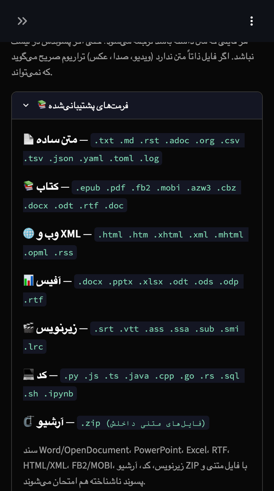
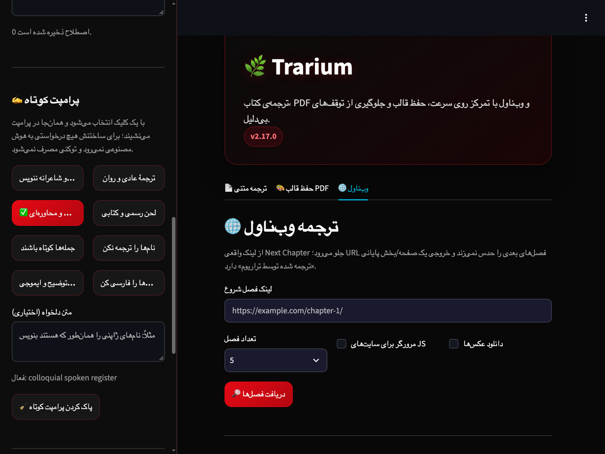
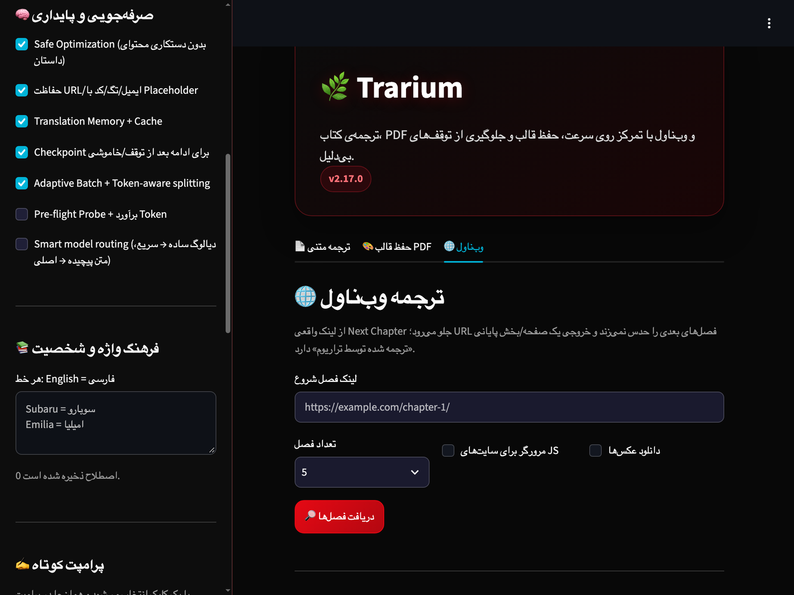
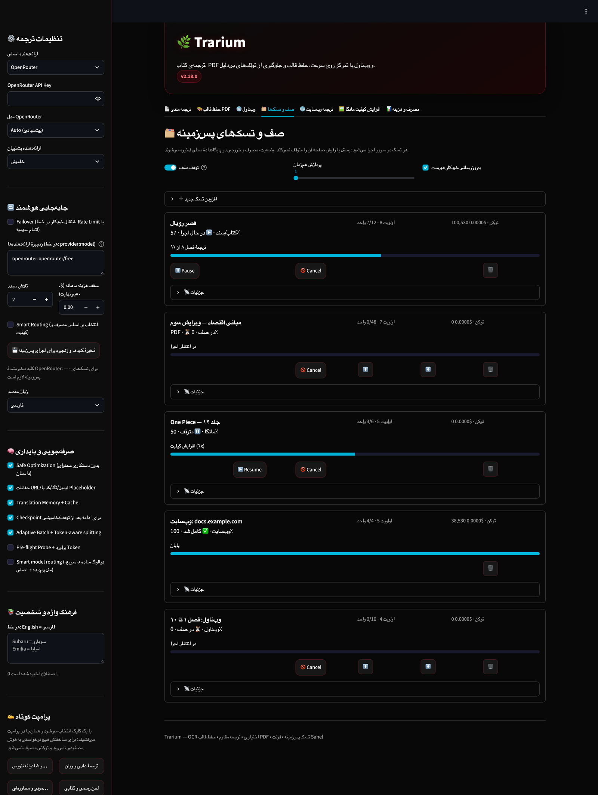
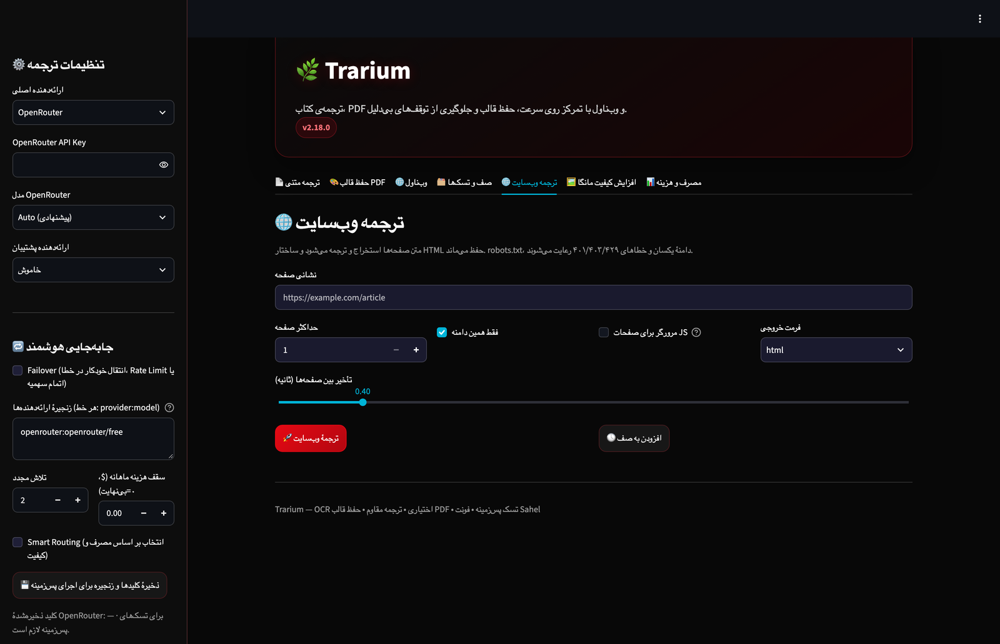
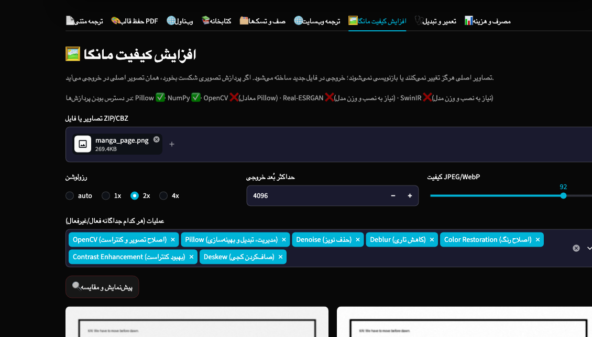
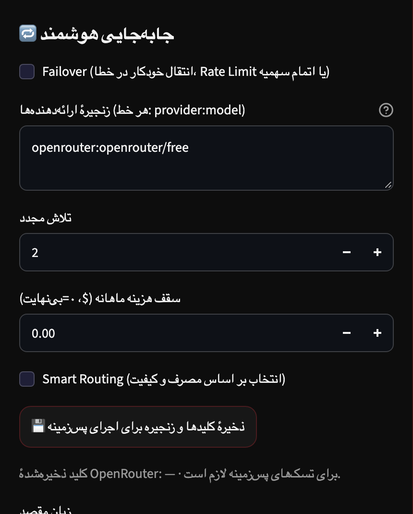
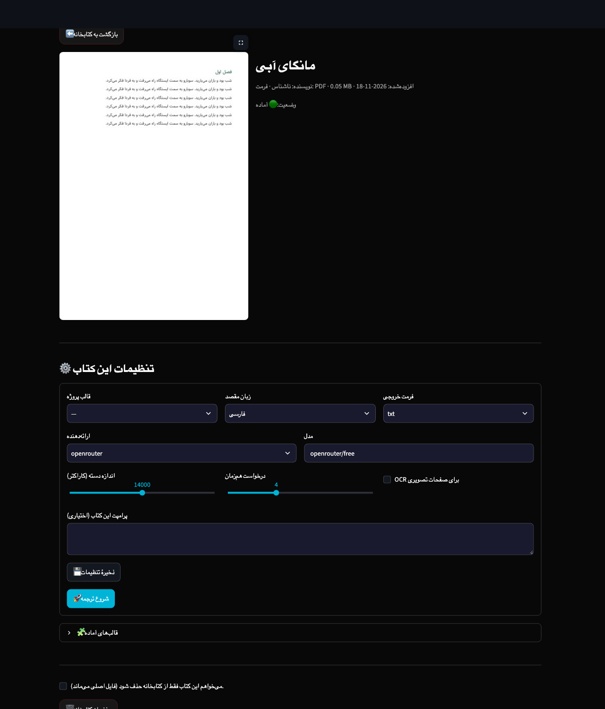
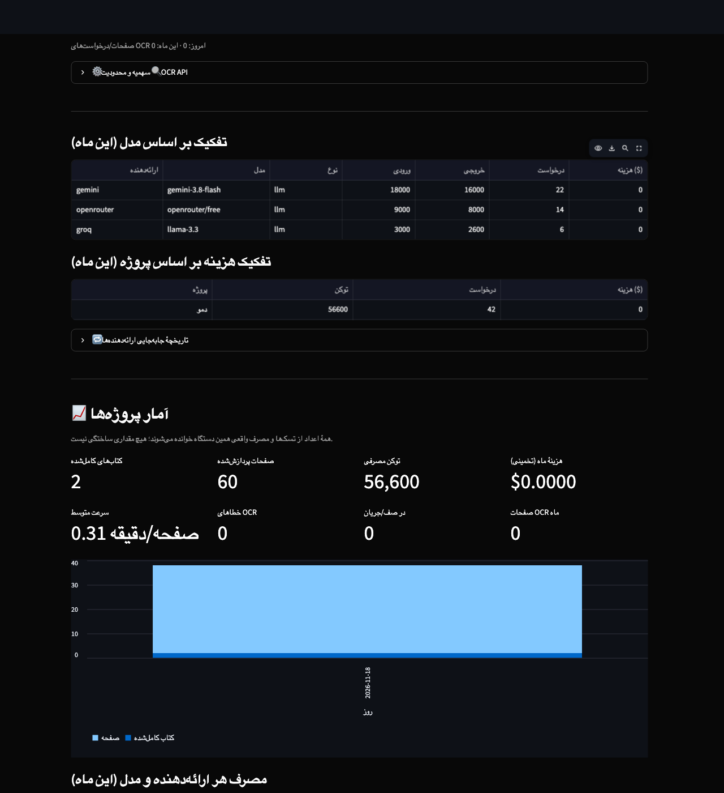

# 🌿 Trarium 1.1

[](https://github.com/Simurghdev1/trarium/actions/workflows/qa.yml)

**تراریوم** یک برنامهٔ ساده برای ترجمهٔ کتاب، PDF، مانگا، وب‌ناول، وب‌سایت و زیرنویس با هوش مصنوعیه.
فایل یا لینک رو می‌دی، زبان مقصد (پیش‌فرض فارسی) رو انتخاب می‌کنی و خروجی رو با همون فرمت اصلی تحویل می‌گیری.
همه‌چیز روی دستگاه خودت (یا سرور خودت) اجرا می‌شه و فقط متن برای ترجمه به سرویس هوش مصنوعی‌ای که انتخاب کردی فرستاده می‌شه.


---

## ✨ چه کارهایی می‌کنه؟

### ترجمه
- **📄 ترجمهٔ متنی:** PDF، EPUB، TXT، DOCX، PPTX، XLSX، HTML و تقریباً هر فایلی که متن داره. خروجی TXT، PDF، EPUB یا HTML با فونت فارسی Sahel.
- **🎨 حفظ قالب PDF:** ترجمه دقیقاً جای متن اصلی نوشته می‌شه؛ رنگ کاغذ، اندازهٔ فونت و چیدمان صفحه حفظ می‌شه. صفحه‌های اسکن‌شده با OCR خونده می‌شن (OCR.space یا مدل تصویری OpenRouter).
- **🖼️ مانگا و اسکن:** عنوان‌ها و حباب‌های گفتگو روی همون جای متن انگلیسی و با همون اندازه نوشته می‌شن؛ نوشته‌های داخل طراحی صفحه دست نمی‌خورن.
- **🌐 وب‌ناول:** لینک فصل اول رو بده؛ تراریوم خودش لینک «فصل بعد» رو دنبال می‌کنه. محدودهٔ فصل (مثلاً ۱ تا ۱۰۰) قابل انتخابه.
- **🌐 وب‌سایت:** یک یا چند صفحه با حفظ ساختار HTML ترجمه می‌شه؛ robots.txt رعایت می‌شه. خروجی HTML، TXT یا EPUB.
- **🎬 زیرنویس یوتیوب:** لینک ویدیو رو بده؛ زیرنویس اصلی (دستی، وگرنه خودکار) با [yt-dlp](https://github.com/yt-dlp/yt-dlp) بدون دانلود ویدیو گرفته، تمیز و با همون زمان‌بندی ترجمه می‌شه. خروجی SRT.
- **🎞️ فایل زیرنویس:** SRT، WebVTT، SBV، LRC، ASS/SSA و MicroDVD با همون زمان‌بندی و همون فرمت برمی‌گردن.
- **🧾 فایل‌های داده و کد:** در JSON/CSV فقط مقدارها، در نوت‌بوک فقط بخش‌های متنی و در کد فقط کامنت‌ها ترجمه می‌شن تا فایل خراب نشه.

### کیفیت و صرفه‌جویی
- **حافظهٔ ترجمه و کش:** متن تکراری یک بار ترجمه می‌شه؛ بعد از قطع شدن، از همون‌جا ادامه می‌ده و بخش‌های ترجمه‌شده دوباره هزینه ندارن.
- **فرهنگ واژه و اسامی:** اسم شخصیت‌ها و اصطلاحات در کل کتاب یکسان می‌مونن.
- **پرامپت کوتاه:** لحن و سبک ترجمه رو با چند انتخاب ساده تعیین کن.
- **محافظت از لینک، ایمیل و کد:** دست‌نخورده در خروجی می‌مونن.

### مدیریت کار
- **🗂️ صف و تسک‌های پس‌زمینه:** چند فایل رو با هم بذار؛ با بستن مرورگر یا ری‌استارت چیزی متوقف نمی‌شه. توقف / ادامه / لغو / حذف.
- **📡 پایش زنده:** توکن، تعداد درخواست، هزینهٔ تخمینی، صفحهٔ فعلی و زمان باقی‌مونده.
- **⏯️ ادامهٔ هوشمند:** بعد از کرش، از آخرین مرحلهٔ موفق ادامه می‌ده.
- **🔁 جابه‌جایی هوشمند ارائه‌دهنده:** اگه یک سرویس خطا یا محدودیت داد، خودکار سراغ بعدی می‌ره. پشتیبانی از OpenRouter، Google Gemini، Groq، 9Router و هر API سازگار با OpenAI.
- **📊 مصرف و هزینه:** توکن و هزینهٔ روزانه/ماهانه، نمودار و سقف هزینه.
- **📚 کتابخانه و پلی‌لیست:** کتاب‌هات رو با جلد، دسته‌بندی و تنظیمات اختصاصی نگه دار.
- **🧩 قالب‌های آماده:** Manga، Manhwa، Manhua، Web Novel، Light Novel، کتاب دانشگاهی و سند فنی.
- **🩺 تعمیر کتاب:** صفحه‌های تکراری، سفید، خراب یا جابه‌جا پیدا و در یک فایل جدید اصلاح می‌شن.
- **🔄 تبدیل فرمت:** PDF، EPUB، DOCX، HTML و TXT به هم.
- **🖼️ افزایش کیفیت مانگا:** حذف نویز، رفع تاری، بزرگ‌نمایی ۲x/۴x (با Real-ESRGAN/SwinIR اختیاری) و مقایسهٔ قبل و بعد.

---

## 🚀 اجرا

### ویندوز
```bat
install_core.bat
run_trarium.bat
```

### لینوکس / مک / ترموکس
```bash
pip install -r requirements.txt
streamlit run streamlit_app.py
```
بعد آدرس `http://localhost:8501` رو باز کن، کلید API یک سرویس رو در نوار کنار وارد کن و شروع کن.

> OCR سنگین (PaddleOCR، EasyOCR، Surya) اختیاریه: `pip install -r requirements-ocr.txt`
> برای سایت‌های جاوااسکریپتی: `pip install playwright && playwright install chromium`

---

## ☁️ دیپلوی روی Railway (یا هر سرویس Docker)

1. ریپو رو در Railway وصل کن؛ `Dockerfile` و `railway.json` آماده‌ان و پورت از `$PORT` خونده می‌شه.
2. یک Volume روی مسیر `/root/.trarium` وصل کن تا تسک‌ها، کش و کتابخانه بعد از ری‌استارت بمونن.
3. متغیرهای محیطی رو در بخش Variables بذار (هیچ کلیدی داخل کد نیست و نباید باشه):

| متغیر | کاربرد |
|---|---|
| `TRARIUM_APP_PASSWORD` | **روی سرور عمومی حتماً بذار.** بدون رمز، هر کسی می‌تونه با کلیدهای تو ترجمه کنه. |
| `OPENROUTER_API_KEY` | کلید OpenRouter |
| `GOOGLE_API_KEY` | کلید Google Gemini |
| `GROQ_API_KEY` | کلید Groq |
| `TRARIUM_API_KEY`، `TRARIUM_BASE_URL`، `TRARIUM_MODEL` | هر API سازگار با OpenAI (کلید فقط به همین Base URL فرستاده می‌شه) |
| `TRARIUM_OCR_SPACE_KEY` | کلید OCR.space برای صفحه‌های اسکن‌شده (بدون آن، کلید عمومی محدود استفاده می‌شه) |
| `TRARIUM_YT_COOKIES`، `TRARIUM_YT_PROXY` | اختیاری؛ یوتیوب IP سرورها رو می‌بنده، با فایل کوکی یا پروکسی باز می‌شه. فایل کوکی رو می‌شه در خود تب یوتیوب هم آپلود کرد. |
| `TRARIUM_HOME` | مسیر داده‌ها (پیش‌فرض `~/.trarium`) |

کلیدهای سرور هیچ‌وقت به مرورگر فرستاده نمی‌شن و در رابط کاربری نمایش داده نمی‌شن.

---

## 🔒 داده‌ها و امنیت
- همهٔ داده‌ها در `~/.trarium` می‌مونن: تسک‌ها، مصرف، کش، کتابخانه و فایل‌های خروجی.
- درخواست به آدرس‌های داخلی شبکه (localhost، 10.x، 169.254.x و…) در ترجمهٔ وب‌سایت و وب‌ناول مسدوده.
- فایل کوکی یوتیوب فقط برای همون دریافت استفاده و بلافاصله پاک می‌شه.

---

## 🧪 تست
```bash
python -m pytest tests -q
```

---

## 🗂️ ساختار پروژه
```text
streamlit_app.py      رابط کاربری
trarium/
  translators/        اتصال به سرویس‌های هوش مصنوعی
  extractors/         خواندن فرمت‌ها
  pdf_optimized.py    ترجمه با حفظ قالب PDF
  ocr_space.py        OCR صفحه‌های اسکن‌شده
  youtube.py          زیرنویس یوتیوب
  websites.py         ترجمهٔ وب‌سایت
  novel/              وب‌ناول
  jobs/               صف و تسک‌های پس‌زمینه
  fonts/Sahel.ttf
tests/
```

---

## 🖼️ تصاویر برنامه

### 📚 فرمت‌های پشتیبانی‌شده


### 🎨 حفظ قالب PDF


### 🌐 ترجمهٔ وب‌ناول


### ✍️ پرامپت کوتاه



### ⚡ سرعت و کنترل درخواست‌ها


### 🧠 صرفه‌جویی، فرهنگ واژه و شخصیت


### 🗂️ صف و تسک‌های پس‌زمینه


### 📡 پایش زندهٔ یک تسک


### 🌐 ترجمهٔ وب‌سایت


### 🖼️ افزایش کیفیت مانگا




### 📊 مصرف و هزینه


### 🔁 جابه‌جایی هوشمند ارائه‌دهنده


### 📚 کتابخانه و پلی‌لیست


### 📖 صفحهٔ اختصاصی هر کتاب


### 🩺 تعمیر خودکار کتاب


### 🔄 تبدیل فرمت


### 📈 آمار پروژه‌ها


### ⏯️ ادامهٔ هوشمند


---

مجوز: MIT — جزئیات در [LICENSE](LICENSE). نسخه‌ها: [CHANGELOG](CHANGELOG.md).
