# 🌿 Trarium 1.1

> 📘 **نسخهٔ این راهنما (README): 1.2** — نسخهٔ خود برنامه همچنان 1.1.0 است.

[](https://github.com/Simurghdev1/trarium/actions/workflows/qa.yml)

**تراریوم** یک برنامهٔ ساده برای ترجمهٔ کتاب، PDF، مانگا، وب‌ناول، وب‌سایت، زیرنویس و **بازی / ویژوال ناول** با هوش مصنوعیه.
فایل یا لینک رو می‌دی، زبان مقصد (پیش‌فرض فارسی) رو انتخاب می‌کنی و خروجی رو با همون فرمت اصلی تحویل می‌گیری.
همه‌چیز روی دستگاه خودت (یا سرور خودت) اجرا می‌شه و فقط متن برای ترجمه به سرویس هوش مصنوعی‌ای که انتخاب کردی فرستاده می‌شه.


---

## ✨ چه کارهایی می‌کنه؟

### ترجمه
- **📄 ترجمهٔ متنی:** PDF، EPUB، TXT، DOCX، PPTX، XLSX، HTML و تقریباً هر فایلی که متن داره. خروجی TXT، PDF، EPUB یا HTML با فونت فارسی Sahel.
- **🎨 حفظ قالب PDF:** ترجمه دقیقاً جای متن اصلی نوشته می‌شه؛ رنگ کاغذ، اندازهٔ فونت و چیدمان صفحه حفظ می‌شه. صفحه‌های اسکن‌شده با OCR خونده می‌شن (OCR.space یا مدل تصویری OpenRouter).
- **🖼️ مانگا و اسکن:** عنوان‌ها و حباب‌های گفتگو روی همون جای متن انگلیسی و با همون اندازه نوشته می‌شن؛ نوشته‌های داخل طراحی صفحه دست نمی‌خورن.
- **🌐 وب‌ناول:** لینک فصل اول رو بده؛ تراریوم خودش لینک «فصل بعد» رو دنبال می‌کنه. محدودهٔ فصل (مثلاً ۱ تا ۱۰۰) قابل انتخابه.
- **🌐 وب‌سایت:** یک یا چند صفحه با حفظ ساختار HTML ترجمه می‌شه؛ robots.txt رعایت می‌شه. خروجی HTML، TXT یا EPUB.
- **🎬 زیرنویس یوتیوب:** لینک ویدیو رو بده؛ زیرنویس اصلی (دستی، وگرنه خودکار) با [yt-dlp](https://github.com/yt-dlp/yt-dlp) بدون دانلود ویدیو گرفته، تمیز و با همون زمان‌بندی ترجمه می‌شه. خروجی SRT.
- **🎞️ فایل زیرنویس:** SRT، WebVTT، SBV، LRC، ASS/SSA و MicroDVD با همون زمان‌بندی و همون فرمت برمی‌گردن.
- **🎮 بازی و ویژوال ناول:** Ren'Py، RPG Maker (MV/MZ و XP/VX/VX Ace)، TyranoScript، GameMaker Studio (data.win) و GameMaker 8؛ برای موتورهای دیگر مسیر عمومی با تشخیص متن به کمک هوش مصنوعی. هر نوع فایلی (حتی ISO) تا ۲ گیگابایت. [جزئیات ↓](#-ترجمهٔ-بازی-و-ویژوال-ناول)
- **🧾 فایل‌های داده و کد:** در JSON/CSV فقط مقدارها، در نوت‌بوک فقط بخش‌های متنی و در کد فقط کامنت‌ها ترجمه می‌شن تا فایل خراب نشه.

### کیفیت و صرفه‌جویی
- **حافظهٔ ترجمه و کش:** متن تکراری یک بار ترجمه می‌شه؛ بعد از قطع شدن، از همون‌جا ادامه می‌ده و بخش‌های ترجمه‌شده دوباره هزینه ندارن.
- **فرهنگ واژه و اسامی:** اسم شخصیت‌ها و اصطلاحات در کل کتاب یکسان می‌مونن.
- **پرامپت کوتاه:** لحن و سبک ترجمه رو با چند انتخاب ساده تعیین کن.
- **محافظت از لینک، ایمیل و کد:** دست‌نخورده در خروجی می‌مونن.

### مدیریت کار
- **🗂️ صف و تسک‌های پس‌زمینه:** چند فایل رو با هم بذار؛ با بستن مرورگر یا ری‌استارت چیزی متوقف نمی‌شه. توقف / ادامه / لغو / حذف.
- **📡 پایش زنده:** توکن، تعداد درخواست، هزینهٔ تخمینی، صفحهٔ فعلی و زمان باقی‌مونده.
- **⏯️ ادامهٔ هوشمند:** بعد از کرش، از آخرین مرحلهٔ موفق ادامه می‌ده.
- **🔁 جابه‌جایی هوشمند ارائه‌دهنده:** اگه یک سرویس خطا یا محدودیت داد، خودکار سراغ بعدی می‌ره. پشتیبانی از OpenRouter، Google Gemini، Groq، 9Router و هر API سازگار با OpenAI.
- **📊 مصرف و هزینه:** توکن و هزینهٔ روزانه/ماهانه، نمودار و سقف هزینه.
- **📚 کتابخانه و پلی‌لیست:** کتاب‌هات رو با جلد، دسته‌بندی و تنظیمات اختصاصی نگه دار.
- **🧩 قالب‌های آماده:** Manga، Manhwa، Manhua، Web Novel، Light Novel، کتاب دانشگاهی و سند فنی.
- **🩺 تعمیر کتاب:** صفحه‌های تکراری، سفید، خراب یا جابه‌جا پیدا و در یک فایل جدید اصلاح می‌شن.
- **🔄 تبدیل فرمت:** PDF، EPUB، DOCX، HTML و TXT به هم.
- **🖼️ افزایش کیفیت مانگا:** حذف نویز، رفع تاری، بزرگ‌نمایی ۲x/۴x (با Real-ESRGAN/SwinIR اختیاری) و مقایسهٔ قبل و بعد.

---

## 🎮 ترجمهٔ بازی و ویژوال ناول

تب «🎮 ویژوال ناول» بازی رو می‌گیره، موتورش رو از روی **محتوای فایل‌ها** (نه فقط پسوند) تشخیص می‌ده، تعداد خط‌های قابل ترجمه رو بدون هیچ درخواست API نشون می‌ده و بعد با همون ارائه‌دهنده‌ای که در نوار کنار انتخاب کردی ترجمه می‌کنه. کدهای کنترلی بازی (مثل `\C[2]`، `\E1`، `^1`، `&`، `%s`، `{0}`، تگ‌ها) قفل می‌شن و هر ترجمه‌ای که کدی رو گم کنه رد می‌شه و متن اصلی می‌مونه.

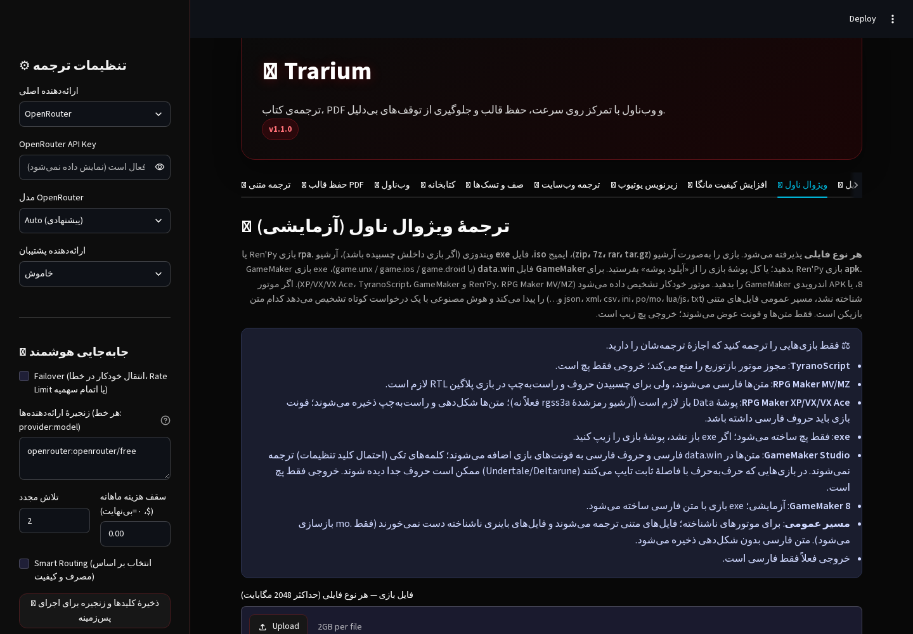

### موتورهای پشتیبانی‌شده

| موتور | ورودی | چه چیزی عوض می‌شه | نکته |
|---|---|---|---|
| **Ren'Py** | پوشه/زیپ، `.rpa`، exe با بازی چسبیده، APK | دیالوگ، گزینه‌ها، رابط + فونت فارسی و راست‌به‌چپ | APK به Ren'Py SDK و unrpyc روی سرور نیاز داره |
| **RPG Maker MV/MZ** | پوشه/زیپ (`www/data`) | پیام‌ها، گزینه‌ها، دیتابیس | برای چسبیدن حروف در بازی پلاگین RTL لازمه |
| **RPG Maker XP/VX/VX Ace** | پوشهٔ `Data` با `.rxdata/.rvdata/.rvdata2` | پیام‌ها (101/401/405)، گزینه‌ها، دیتابیس | متن شکل‌دهی و راست‌به‌چپ ذخیره می‌شه؛ فونت بازی باید حروف فارسی داشته باشه. آرشیو رمزشدهٔ `Game.rgss3a` فعلاً باز نمی‌شه |
| **TyranoScript** | پوشه/زیپ | متن، اسم‌ها، دکمه‌ها + فونت و CSS راست‌به‌چپ | مجوز موتور بازتوزیع رو منع می‌کنه؛ خروجی فقط پچه |
| **GameMaker Studio 1/2** | `data.win`، `game.unx`، `game.ios`، `game.droid`، پوشه/زیپ، APK (`assets/game.droid`) | رشته‌های دیالوگ و رابط در STRG + **حروف فارسی به فونت‌های بیت‌مپ بازی اضافه می‌شن** | شناسه‌ها، اسم فایل/اسپرایت و کلمه‌های تکی (احتمال کلید تنظیمات) ترجمه نمی‌شن |
| **GameMaker 8** | فایل exe بازی | متن‌ها + فونت؛ exe فارسی ساخته می‌شه | آزمایشی؛ برای نویسندهٔ دیالوگ شبیه Undertale |
| **مسیر عمومی** | هر چیز دیگه | فایل‌های متنی (json، xml/html/plist، csv، ini، yaml، po/mo، strings، lua/js و اسکریپت‌ها، txt) | پایین‌تر توضیح داده شده |

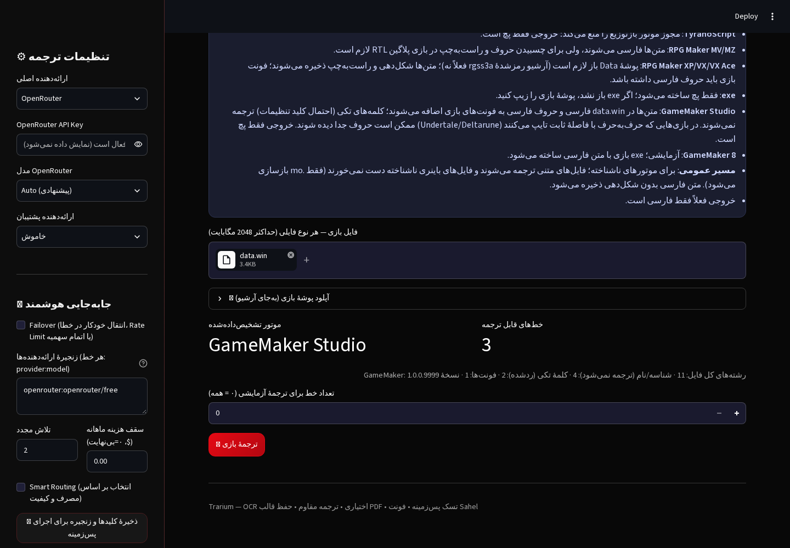

**GameMaker چطور کار می‌کنه:** هیچ بایتی از فایل جابه‌جا نمی‌شه؛ رشته‌های فارسی و فونت بازسازی‌شده به انتهای فایل اضافه می‌شن و فقط اشاره‌گرها (جدول STRG، فهرست FONT، صفحهٔ بافت TXTR) به نسخهٔ جدید اشاره می‌کنن. متن فارسی از قبل شکل‌دهی (حروف چسبیده) و به ترتیب نمایش ذخیره می‌شه، چون موتور GameMaker خودش راست‌به‌چپ نمی‌نویسه. گلیف‌ها از فونت Sahel به اندازهٔ فونت خود بازی ساخته می‌شن:

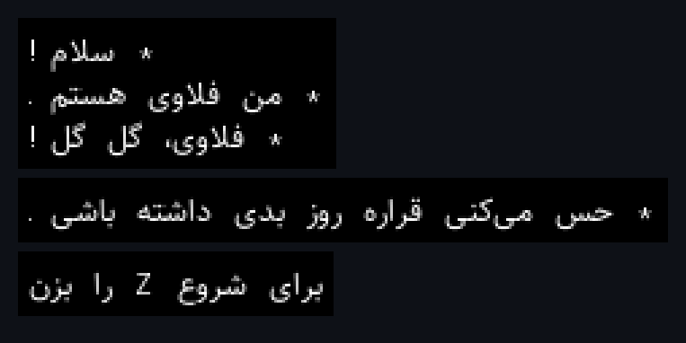

> ⚠️ وضعیت GameMaker Studio: روی فایل‌های ساختگی تست و با پیش‌نمایش آفلاین بررسی شده، ولی هنوز داخل خود موتور GameMaker اجرا نشده. بازی‌هایی که متن رو حرف‌به‌حرف با فاصلهٔ ثابت تایپ می‌کنن (مثل Undertale/Deltarune) ممکنه حروف فارسی رو جدا از هم نشون بدن؛ این کار برای هر بازی پچ کد جدا لازم داره. فقط صفحه‌های بافت PNG پشتیبانی می‌شن (نه QOI/BZ2 نسخه‌های جدید GMS2).

### مسیر عمومی (موتورهای ناشناخته)
1. هر آرشیوی که بشه باز کرد (zip، tar، 7z/rar اگه ابزارش نصب باشه، ISO) و آرشیوهای تودرتو تا دو سطح باز می‌شن.
2. فایل‌های متنی از روی محتوا پیدا می‌شن (UTF-8، UTF-16، Shift-JIS، cp1252).
3. **یک درخواست کوتاه و ارزان** به همون ارائه‌دهنده، روی نمونهٔ کوچکی از رشته‌ها، تعیین می‌کنه کدوم گروه‌ها (فایل + کلید) متن بازیکن‌اند و کدوم کد/شناسه. اگه این پاسخ در دسترس نباشه، یک قاعدهٔ محتاطانه جاش کار می‌کنه.
4. ترجمه با قفل کامل تگ‌ها و جای‌نگهدارها؛ فایل با همون کدگذاری ذخیره می‌شه (اگه کدگذاری حروف فارسی نداشته باشه، UTF-8 و در گزارش ذکر می‌شه). متن فارسی در این مسیر شکل‌دهی نمی‌شه، چون موتور بازی معلوم نیست.
5. فایل‌های باینری ناشناخته **هرگز تغییر نمی‌کنن** (فقط `.mo` که ساختارش معلومه بازسازی می‌شه)؛ تعداد رشته‌هایی که در آن‌ها پیدا شد و دلیل ترجمه نشدن به فارسی نشون داده می‌شه.

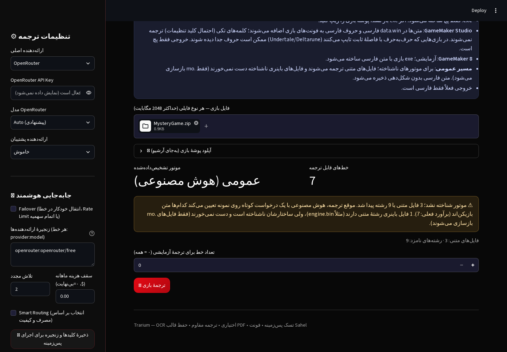

### ورودی، خروجی و حجم
- **هر نوع فایلی** پذیرفته می‌شه: zip، 7z، rar، tar(.gz/.bz2/.xz)، **iso** (ISO 9660 / Joliet / UDF)، exe، apk، rpa، data.win و… یا کل پوشهٔ بازی از «آپلود پوشه».
- ISO با `7z` (اگه نصب باشه) وگرنه با کتابخانهٔ پایتونی سبک `pycdlib` باز می‌شه؛ خود ISO هیچ‌وقت دوباره ساخته نمی‌شه.
- خروجی همیشه **پچ زیپ** (فقط فایل‌های عوض‌شده) است؛ exe و ISO دوباره بسته‌بندی نمی‌شن (به‌جز GameMaker 8 که خودِ exe حامل متن‌هاست، و APK که اگه ابزار امضا روی سرور باشه امضا می‌شه).
- محافظت: جلوی مسیرهای بیرون‌زده (zip-slip) و لینک‌های نمادین گرفته می‌شه، سقف حجم بازشده هست، و هیچ دادهٔ آپلودشده‌ای با pickle/eval اجرا نمی‌شه.
- **سقف آپلود: ۲ گیگابایت** (`server.maxUploadSize = 2048`)، سقف حجم بازشده ۶ گیگابایت. با متغیرهای `TRARIUM_VN_MAX_MB` و `TRARIUM_VN_MAX_UNPACKED_MB` قابل تغییره.

> ⚠️ **پیش‌نیاز سرور برای فایل‌های بزرگ:** Streamlit فایل آپلودی رو در حافظه نگه می‌داره، پس آپلود ۲ گیگی خودش حدود ۲ گیگ RAM می‌گیره؛ فایل دادهٔ GameMaker هم موقع پچ کامل در حافظه خونده می‌شه. برای بازی‌های چندگیگی حداقل ۴ تا ۶ گیگ RAM و حدود ۱۰ گیگ فضای خالی موقت (فایل آپلود + محتوای بازشده + پچ) در نظر بگیر. اگه جلوی سرور Cloudflare (پلن رایگان/Pro) یا یک reverse-proxy باشه، سقف حجم درخواست اون (مثلاً ۱۰۰ مگ در Cloudflare رایگان، یا `client_max_body_size` در nginx) زودتر جلوی آپلود رو می‌گیره. محدودیت‌های پراکسی و پلن Railway رو هم چک کن.

<p align="center">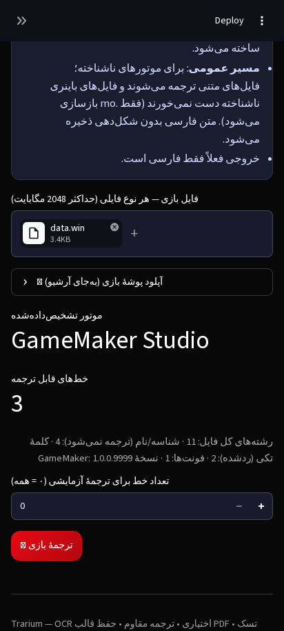</p>

⚖️ فقط بازی‌هایی رو ترجمه کن که اجازهٔ ترجمه‌شون رو داری. تراریوم هیچ دادهٔ بازی‌ای همراه خودش نداره و همهٔ تصاویر این بخش از نمونه‌های ساختگی‌اند.

---

## 🚀 اجرا

### ویندوز
```bat
install_core.bat
run_trarium.bat
```

### لینوکس / مک / ترموکس
```bash
pip install -r requirements.txt
streamlit run streamlit_app.py
```
بعد آدرس `http://localhost:8501` رو باز کن، کلید API یک سرویس رو در نوار کنار وارد کن و شروع کن.

> OCR سنگین (PaddleOCR، EasyOCR، Surya) اختیاریه: `pip install -r requirements-ocr.txt`
> برای سایت‌های جاوااسکریپتی: `pip install playwright && playwright install chromium`

---

## ☁️ دیپلوی روی Railway (یا هر سرویس Docker)

1. ریپو رو در Railway وصل کن؛ `Dockerfile` و `railway.json` آماده‌ان و پورت از `$PORT` خونده می‌شه.
2. یک Volume روی مسیر `/root/.trarium` وصل کن تا تسک‌ها، کش و کتابخانه بعد از ری‌استارت بمونن.
3. متغیرهای محیطی رو در بخش Variables بذار (هیچ کلیدی داخل کد نیست و نباید باشه):

| متغیر | کاربرد |
|---|---|
| `TRARIUM_APP_PASSWORD` | **روی سرور عمومی حتماً بذار.** بدون رمز، هر کسی می‌تونه با کلیدهای تو ترجمه کنه. |
| `OPENROUTER_API_KEY` | کلید OpenRouter |
| `GOOGLE_API_KEY` | کلید Google Gemini |
| `GROQ_API_KEY` | کلید Groq |
| `TRARIUM_API_KEY`، `TRARIUM_BASE_URL`، `TRARIUM_MODEL` | هر API سازگار با OpenAI (کلید فقط به همین Base URL فرستاده می‌شه) |
| `TRARIUM_OCR_SPACE_KEY` | کلید OCR.space برای صفحه‌های اسکن‌شده (بدون آن، کلید عمومی محدود استفاده می‌شه) |
| `TRARIUM_YT_COOKIES`، `TRARIUM_YT_PROXY` | اختیاری؛ یوتیوب IP سرورها رو می‌بنده، با فایل کوکی یا پروکسی باز می‌شه. فایل کوکی رو می‌شه در خود تب یوتیوب هم آپلود کرد. |
| `TRARIUM_HOME` | مسیر داده‌ها (پیش‌فرض `~/.trarium`) |
| `TRARIUM_VN_MAX_MB`، `TRARIUM_VN_MAX_UNPACKED_MB` | سقف آپلود و سقف حجم بازشدهٔ تب بازی (پیش‌فرض ۲۰۴۸ و ۶۱۴۴ مگابایت). سقف کلی Streamlit با `STREAMLIT_SERVER_MAX_UPLOAD_SIZE` (در Dockerfile ۲۰۴۸) تعیین می‌شه |
| `TRARIUM_RENPY_SDK`، `TRARIUM_UNRPYC` | اختیاری؛ فقط برای ترجمهٔ APK بازی‌های Ren'Py |

کلیدهای سرور هیچ‌وقت به مرورگر فرستاده نمی‌شن و در رابط کاربری نمایش داده نمی‌شن.

---

## 🔒 داده‌ها و امنیت
- همهٔ داده‌ها در `~/.trarium` می‌مونن: تسک‌ها، مصرف، کش، کتابخانه و فایل‌های خروجی.
- درخواست به آدرس‌های داخلی شبکه (localhost، 10.x، 169.254.x و…) در ترجمهٔ وب‌سایت و وب‌ناول مسدوده.
- فایل کوکی یوتیوب فقط برای همون دریافت استفاده و بلافاصله پاک می‌شه.

---

## 🧪 تست
```bash
python -m pytest tests -q
```

---

## 🗂️ ساختار پروژه
```text
streamlit_app.py      رابط کاربری
trarium/
  translators/        اتصال به سرویس‌های هوش مصنوعی
  extractors/         خواندن فرمت‌ها
  pdf_optimized.py    ترجمه با حفظ قالب PDF
  ocr_space.py        OCR صفحه‌های اسکن‌شده
  youtube.py          زیرنویس یوتیوب
  websites.py         ترجمهٔ وب‌سایت
  novel/              وب‌ناول
  jobs/               صف و تسک‌های پس‌زمینه
  vn_tab.py           تب بازی و ویژوال ناول
  vn/                 موتورها: renpy، rpgmaker (MV/MZ)، rgss (XP/VX/Ace)، tyrano، gms (GameMaker Studio)،
                      gm8 (GameMaker 8)، generic (مسیر عمومی)، apk
  fonts/Sahel.ttf
tests/
```

---

## 🖼️ تصاویر برنامه

### 📚 فرمت‌های پشتیبانی‌شده


### 🎨 حفظ قالب PDF


### 🌐 ترجمهٔ وب‌ناول
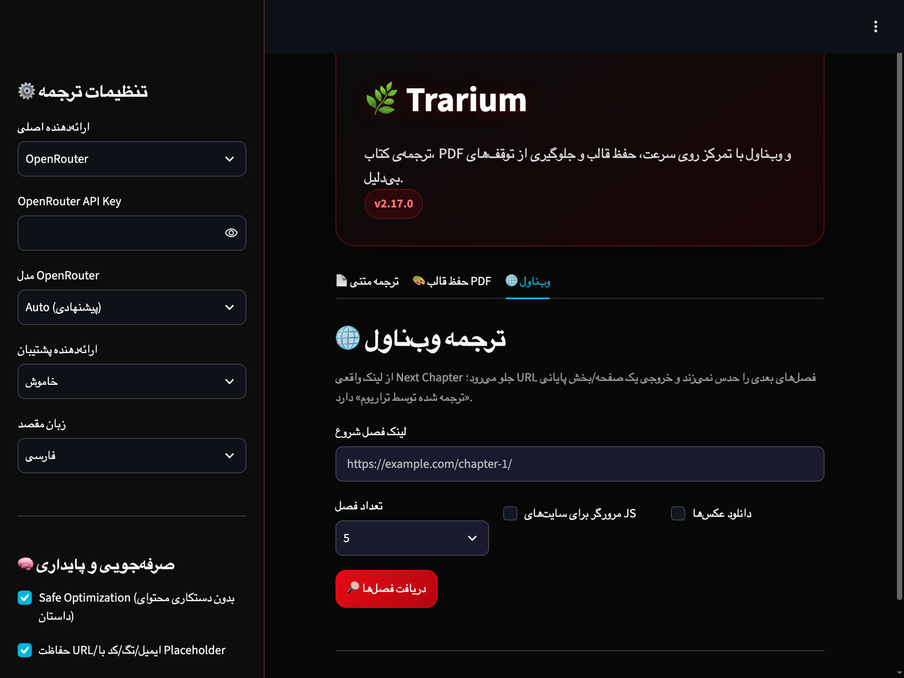

### ✍️ پرامپت کوتاه
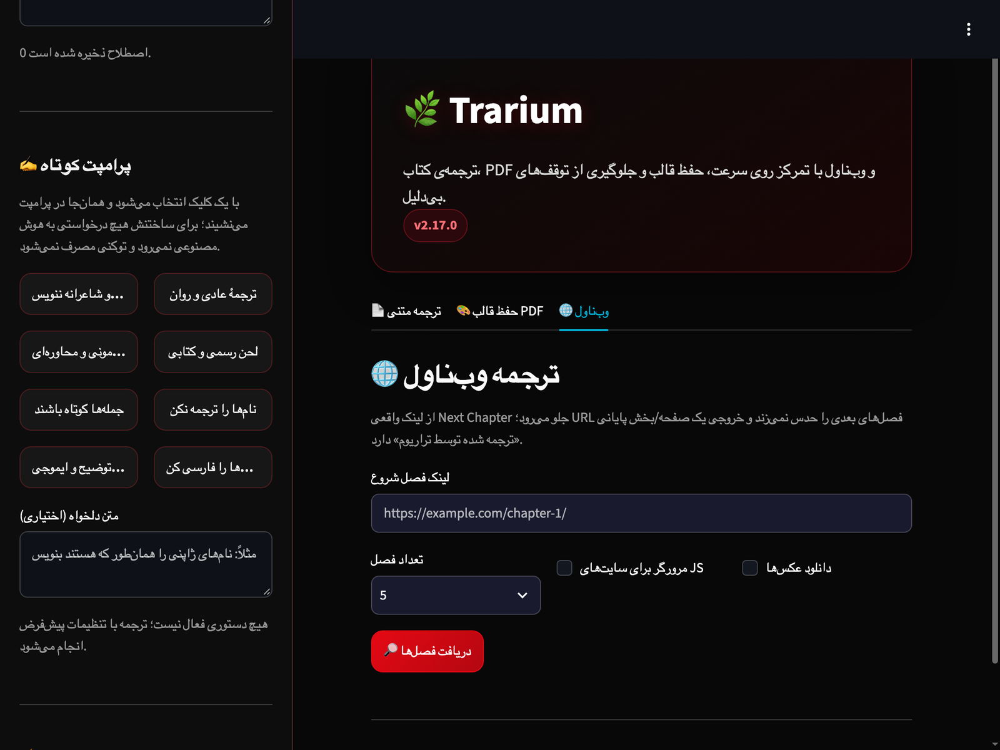


### ⚡ سرعت و کنترل درخواست‌ها


### 🧠 صرفه‌جویی، فرهنگ واژه و شخصیت


### 🗂️ صف و تسک‌های پس‌زمینه


### 📡 پایش زندهٔ یک تسک


### 🌐 ترجمهٔ وب‌سایت


### 🖼️ افزایش کیفیت مانگا


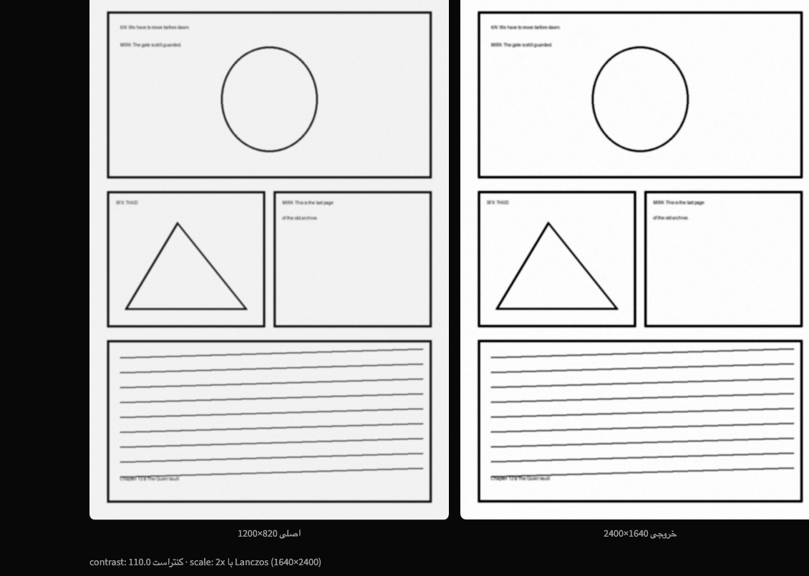

### 📊 مصرف و هزینه
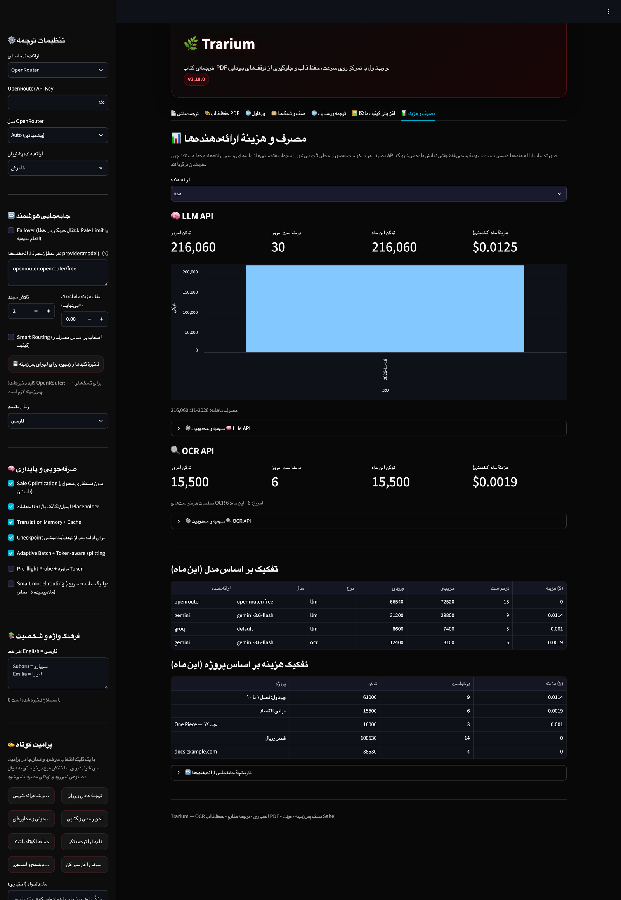

### 🔁 جابه‌جایی هوشمند ارائه‌دهنده


### 📚 کتابخانه و پلی‌لیست
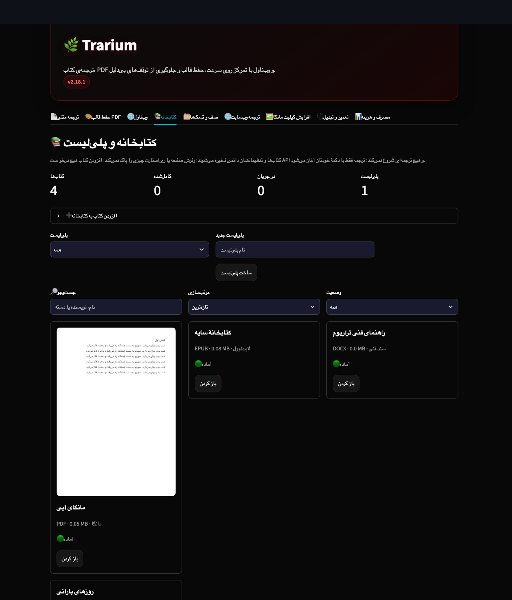

### 📖 صفحهٔ اختصاصی هر کتاب


### 🩺 تعمیر خودکار کتاب
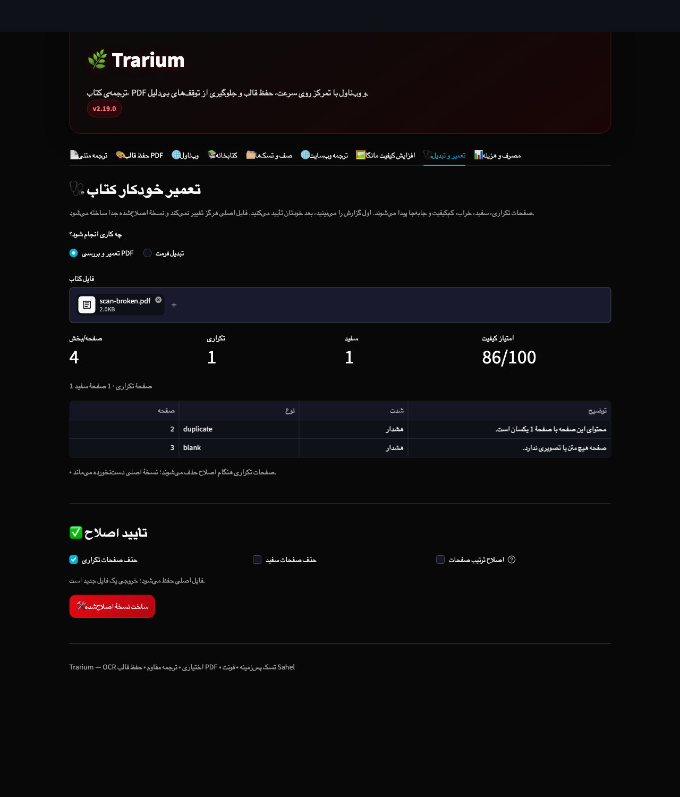

### 🔄 تبدیل فرمت
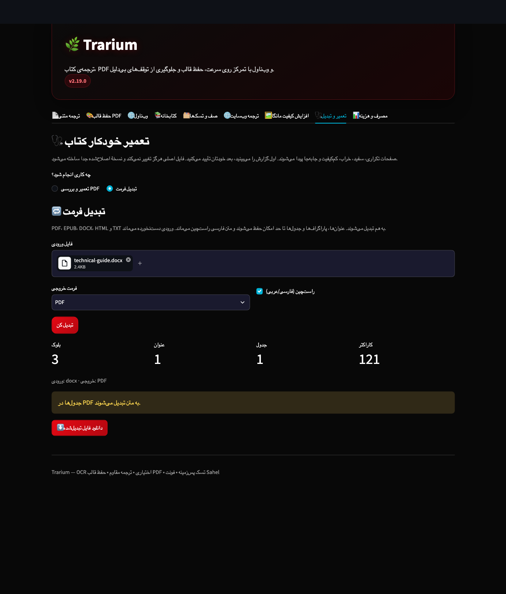

### 📈 آمار پروژه‌ها


### ⏯️ ادامهٔ هوشمند
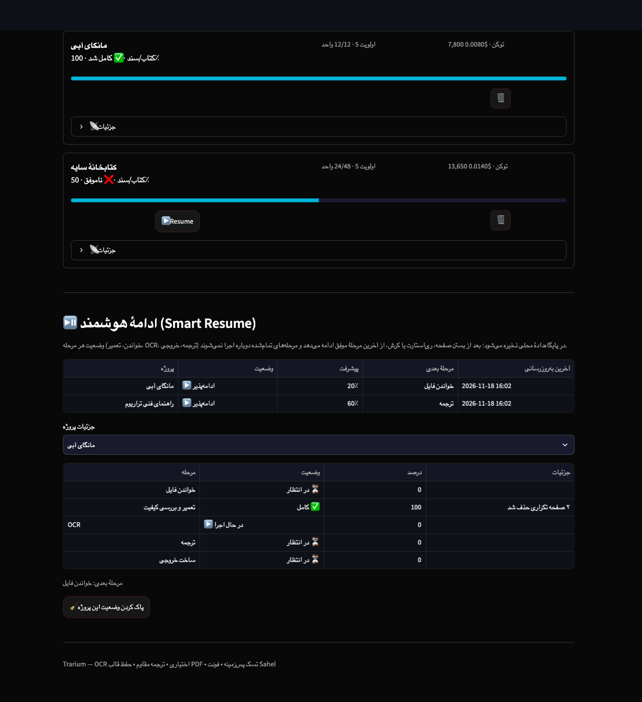

---

مجوز: MIT — جزئیات در [LICENSE](LICENSE). نسخه‌ها: [CHANGELOG](CHANGELOG.md).
