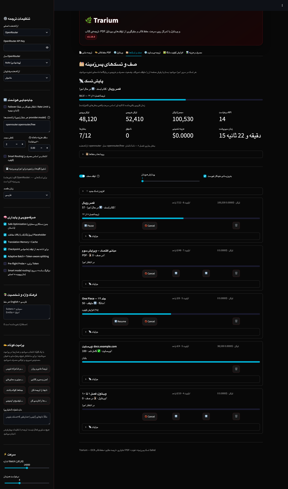
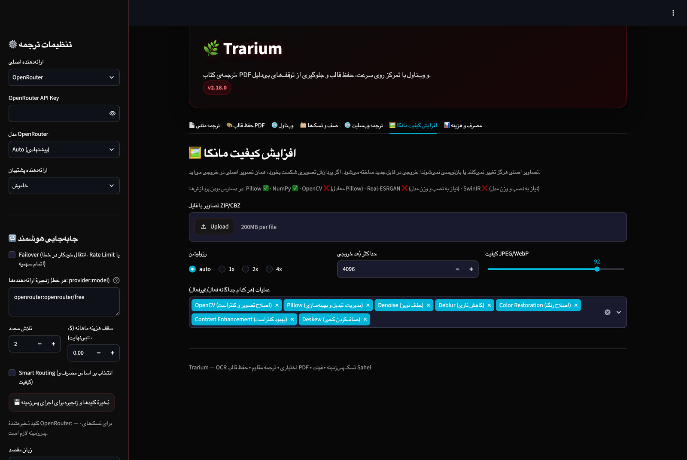
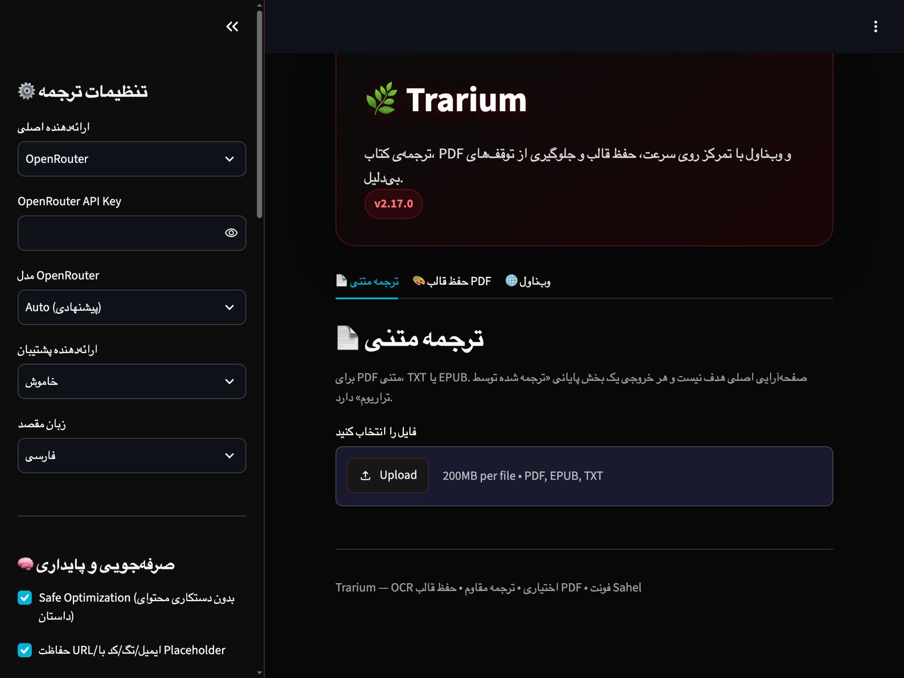
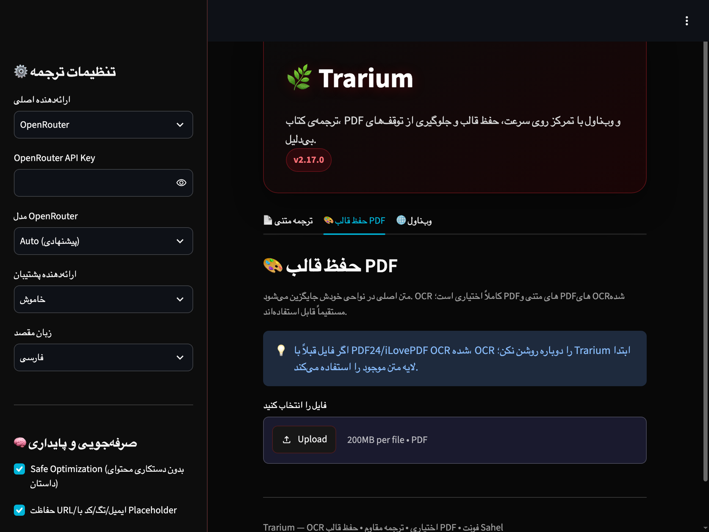
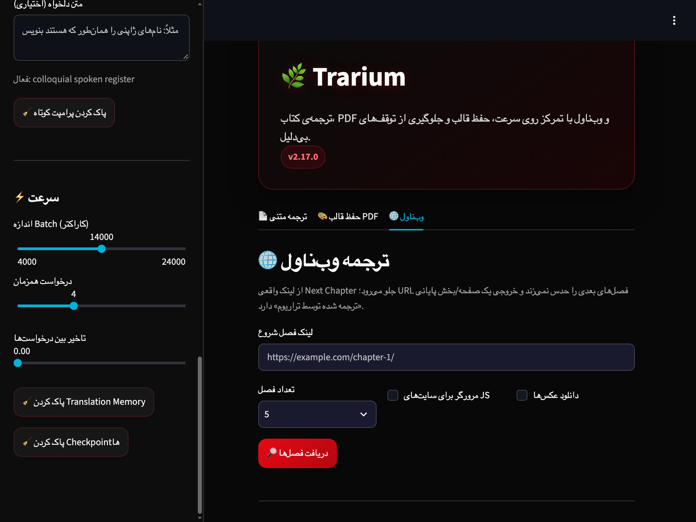

# Trarium 2.18


> **فایل‌های سنگین تست (PDF/PNG خروجی و ورودی) از این ریپو به [trarium-files](https://github.com/alimahamdarijanipro-stack/trarium-files) منتقل شده‌اند تا کلون‌کردن کد سبک بماند؛ لینک‌های زیر به همان‌جا اشاره می‌کنند.**

[](https://github.com/alimahamdarijanipro-stack/trarium-/actions/workflows/qa.yml)

📦 **[خروجی‌های تست و اکشنز (Release)](https://github.com/alimahamdarijanipro-stack/trarium-/releases/tag/qa-2.17.0-2026-11-13)** — PDF گزارش، بستهٔ آرتیفکت و لاگ اجرا.

🧪 **[خروجی تست چینی → فارسی](https://github.com/alimahamdarijanipro-stack/trarium-files/blob/main/qa/outputs/zh-to-fa/trarium_zh_to_fa_text.pdf)** — PDF فارسی ساخته‌شده توسط خود تراریوم، همراه با [گزارش کامل](QA_REPORT.md).

📋 **[گزارش تست و ممیزی (QA_REPORT.md)](QA_REPORT.md)** — نتایج واقعی تست‌های واحد، مجموعهٔ QA، و گردش‌کار PDF با فایل‌های ورودی واقعی، عددهای اندازه‌گیری‌شده و تصویر صفحات.

نسخهٔ جدید هستهٔ ترجمه با تمرکز روی حفظ متن، کاهش مصرف API و امکان ادامهٔ امن کار.

### قابلیت‌های 2.17
- استخراج متن PDF قبل از OCR و اجرای OCR فقط روی صفحات واقعاً بدون لایهٔ متن
- Safe Optimization بدون حذف محتوای داستان
- Translation Memory / Cache نرمال‌شده و حذف درخواست‌های تکراری
- Checkpoint دائمی SQLite برای resume پس از خاموشی یا خطا
- Batch و تقسیم‌بندی Token-aware با اندازهٔ تطبیقی
- Placeholder برای URL، ایمیل، تگ و کد
- Character/Term Registry برای ثبات اسامی و اصطلاحات
- Fallback Scheduler برای عبور از خطای یک Provider
- Pre-flight estimation و connectivity probe
- حفظ فونت Sahel و صفحهٔ «ترجمه شده توسط تراریوم» در خروجی‌های متنی/PDF/EPUB/HTML

این نسخه بر پایهٔ ساختار 2.16.4 ارتقا داده شده و قابلیت‌های قبلی پروژه حفظ شده‌اند.


## 🚀 قابلیت‌های جدید 2.18.0

هفت قابلیت زیر روی همان معماری هستهٔ ترجمه اضافه شده‌اند؛ ترجمه، OCR، PDF و EPUB قبلی دست‌نخورده مانده‌اند.

### 1) تسک‌های پایدار (Persistent Jobs)
ترجمه در سرور اجرا می‌شود، نه در صفحهٔ مرورگر. وضعیت هر تسک در `~/.trarium/jobs.sqlite3` ذخیره می‌شود؛
بستن/رفرش مرورگر یا ری‌استارت برنامه آن را متوقف نمی‌کند. پس از هر توقف، از آخرین بخش ذخیره‌شده ادامه می‌دهد
و بخش‌های موفق دوباره به API فرستاده نمی‌شوند (Checkpoint + Translation Memory).
دکمه‌های Pause / Resume / Cancel / Delete هر کدام مستقل‌اند و Delete فقط پس از تأیید انجام می‌شود.

### 2) صف ترجمه (Translation Queue)
در تب «صف و تسک‌ها» چند فایل را هم‌زمان اضافه کنید، اولویت بدهید، ترتیب را با ⬆️/⬇️ عوض کنید،
صف را متوقف/ادامه دهید و تعداد پردازش هم‌زمان را تعیین کنید. خطای یک پروژه بقیهٔ صف را متوقف نمی‌کند.
برای وب‌ناول محدودهٔ فصل (مثلاً ۱ تا ۱۰۰ یا ۱۰۱ تا آخر) پشتیبانی می‌شود و هر فصل وضعیت مستقل دارد.

### 3) پایش زندهٔ ترجمه (Show Details)
با روشن‌کردن **Show Details** در نوار کنار یا هنگام ترجمه، توکن ورودی/خروجی، مجموع توکن، تعداد درخواست،
هزینهٔ تخمینی، مرحلهٔ فعلی (OCR/ترجمه/بازبینی/خروجی)، صفحه/بخش جاری، درصد پیشرفت، تعداد باقی‌مانده،
پرووایدر و مدل، خطاها و زمان تقریبی باقی‌مانده نمایش داده می‌شود. تخمین زمان از سرعت واقعی بخش‌های
تکمیل‌شده محاسبه می‌شود و شمارش معکوس ساختگی ندارد. این اطلاعات از پایگاه‌داده خوانده می‌شوند و با Reload از بین نمی‌روند.

### 4) جابه‌جایی هوشمند پرووایدر (Smart Failover)
در نوار کنار یک زنجیرهٔ `provider:model` تعریف کنید (هر خط یک اولویت). حالت‌ها:
Provider Fallback، Model Fallback و Smart Routing. محرک‌ها: Rate Limit (429)، اتمام سهمیه، خطای موقت،
قطع ارتباط، مدل غیرفعال. خطاهای دائمی (400/401/403/مدل نامعتبر) بی‌پایان تکرار نمی‌شوند و درخواست
نامشخص بعد از قطع ارتباط دوباره به همان ارائه‌دهنده فرستاده نمی‌شود. هر جابه‌جایی در تاریخچه ثبت می‌شود
و مصرف/هزینه به تفکیک هر ارائه‌دهنده حساب می‌شود. سقف هزینهٔ ماهانه قابل تنظیم است.

### 5) مصرف و صورتحساب (Usage & Billing)
تب «مصرف و هزینه» برای LLM و OCR جداگانه: توکن ورودی/خروجی، مجموع، مصرف روزانه و ماهانه، تعداد درخواست،
هزینهٔ تخمینی، نمودار مصرف، تفکیک بر اساس مدل و پروژه، محدودیت‌های محلی و هشدار نزدیک‌شدن به سقف،
آخرین زمان به‌روزرسانی و تاریخچهٔ Failover. کلید API فقط ماسک‌شده نمایش داده می‌شود.
اعداد هزینه «تخمینی» هستند و از سهمیهٔ رسمی جدا نمایش داده می‌شوند؛ چون API صورتحساب ارائه‌دهنده‌ها
عمومی نیست، سهمیهٔ رسمی فقط وقتی می‌آید که خود سرویس آن را برگرداند.

### 6) افزایش کیفیت مانگا
تب «افزایش کیفیت مانگا»: حالت Auto/1x/2x/4x و عملیات مستقل Denoise، Deblur، Color Restoration،
Contrast، Deskew، Pillow، OpenCV، Real-ESRGAN و SwinIR. پیش‌نمایش مقایسه‌ای قبل/بعد و گزارش هر مرحله
وجود دارد. تصویر اصلی هرگز بازنویسی نمی‌شود؛ خروجی در فایل/ ZIP جدید ساخته می‌شود و اگر پردازشی شکست بخورد
همان تصویر اصلی در خروجی می‌آید. در حالت Auto، تصاویر باکیفیت پردازش غیرضروری نمی‌شوند.
Real-ESRGAN و SwinIR فقط با نصب و وزن مدل فعال می‌شوند؛ در غیر این صورت از Lanczos استفاده می‌شود و گزارش می‌دهد.
برای Real-ESRGAN مسیر وزن با `TRARIUM_REALESRGAN_MODEL` تنظیم می‌شود. OpenCV اختیاری است
(`pip install -e ".[image-opencv]"`).

### 7) ترجمهٔ وب‌سایت
URL صفحه یا چند صفحه، حفظ ساختار HTML و ترتیب عناصر، حذف ترجمهٔ تکراری، مدیریت لینک‌های داخلی،
وضعیت هر صفحه و ادامه پس از توقف. خروجی HTML (تک‌صفحه یا ZIP چندصفحه)، TXT و EPUB.
`robots.txt` رعایت می‌شود، فقط دامنهٔ شروع دنبال می‌شود و خطاهای 401/403/429 هر صفحه را ناموفق ثبت می‌کنند
بدون متوقف‌کردن بقیه. برای صفحات JavaScript می‌توان Playwright را روشن کرد. صفحه‌های ترجمه‌شده در
`~/.trarium/jobs/<id>/pages` ذخیره می‌شوند تا Resume خروجی کامل بسازد.

### 🖼️ تصاویر قابلیت‌های 2.18
تصاویر زیر از خود برنامهٔ v2.18.0 گرفته شده‌اند. برای اینکه پنل‌ها خالی نباشند، در پایگاه‌دادهٔ محلیِ همان اجرا
چند تسک و رکورد مصرف نمونه ثبت شده بود؛ داده‌ای به کد یا خروجی ترجمه اضافه نشده است.
<br>

#### 🗂️ صف و تسک‌های پس‌زمینه
اولویت، تعداد واحد، توکن، هزینهٔ تخمینی، درصد پیشرفت و دکمه‌های Pause/Resume/Cancel/Delete برای هر تسک.


#### 📡 پایش زندهٔ یک تسک
درصد پیشرفت، مرحلهٔ جاری، توکن ورودی/خروجی، تعداد درخواست، هزینهٔ تخمینی، زمان سپری‌شده و زمان تقریبی باقی‌مانده
بر اساس سرعت واقعی بخش‌های تکمیل‌شده.


#### 🌐 ترجمهٔ وب‌سایت
نشانی صفحه، حداکثر صفحه، محدودکردن به همان دامنه، انتخاب مرورگر برای صفحات JS، فرمت خروجی و تأخیر بین صفحه‌ها.


#### 🖼️ افزایش کیفیت مانگا
حالت رزولوشن، حداکثر بُعد خروجی، کیفیت، و انتخاب جداگانهٔ عملیات‌ها؛ وضعیت در دسترس بودن OpenCV، Real-ESRGAN و SwinIR
همان‌جا اعلام می‌شود.


#### 📊 مصرف و هزینه
مصرف LLM و OCR جداگانه، نمودار مصرف، تفکیک بر اساس مدل و پروژه، و تاریخچهٔ جابه‌جایی ارائه‌دهنده.


#### 🔁 جابه‌جایی هوشمند ارائه‌دهنده
زنجیرهٔ `provider:model`، تعداد تلاش مجدد، سقف هزینهٔ ماهانه و Smart Routing در نوار کنار.


### داده‌های محلی و امنیت
همه چیز در `~/.trarium` است (با `TRARIUM_HOME` قابل تغییر):
- `jobs.sqlite3` — تسک‌ها، واحدها و رویدادها
- `usage.sqlite3` — مصرف، محدودیت‌ها و تاریخچهٔ Failover
- `settings.json` — کلیدهای ذخیره‌شده برای اجرای پس‌زمینه، با دسترسی `600`
- `jobs/<id>/` — فایل ورودی، صفحات میانی و خروجی

کلیدها فقط برای اجرای مستقل از مرورگر ذخیره می‌شوند، هرگز کامل در UI نمایش داده نمی‌شوند و در مخزن کد قرار نمی‌گیرند.

### تست‌ها
```bash
.venv/bin/python -m pytest tests -q   # 89 passed
```
تست‌های جدید: `tests/test_expansion.py` (۲۲ تست) شامل صف/اولویت، Pause/Resume/Cancel/Delete،
بازیابی پس از Crash، Failover (429، خطای دائمی، قطع ارتباط، سقف هزینه)، مصرف و محدودیت،
افزایش کیفیت مانگا روی تصویر واقعی، استخراج/ترجمه/خزش وب‌سایت با سرور محلی و robots.txt.

# 🌿 Trarium 2.17.0

Trarium is a small Streamlit application for translating books and web novels with AI, with an optional OCR layer and a PDF layout-preserving mode.

## What changed in 2.18.0

- Persistent background jobs, queue, live monitor, provider failover, usage ledger, manga enhancement and website translation. See the Persian section above for details.

## What changed in 2.16.2

- Fixed the `ترجمه صفحه ... شامل ... بلاک خالی است` failure mode. Missing markers now trigger per-block recovery instead of aborting the whole page.
- PDF translation now batches blocks across pages and uses parallel requests. One API call is no longer forced per page.
- Failed text-translation chunks keep their original source text instead of disappearing.
- OCR is **optional**. Native PDF text is always tried first. Pages without a text layer are only OCRed when you explicitly enable OCR.
- PaddleOCR integration supports the modern 3.x `predict()` path and legacy 2.x fallback without passing the obsolete `show_log` argument.
- The layout mode can consume PDFs already OCRed by another tool; no second OCR pass is required when a text layer exists.
- Web-novel crawling follows real `rel=next` / “Next Chapter” links and stops on loops instead of inventing chapter URLs.
- Web-novel image downloads are parallelized and deduplicated.
- Added TXT/PDF/EPUB/HTML outputs and bundled the Sahel font for Persian output.
- Reworked the Streamlit UI into three clear modes: text translation, layout-preserving PDF, and web novel.
- Added a small OCR benchmark helper for testing about 10 pages.
- OCR dependencies moved out of the core requirements; Tesseract remains available only as an explicit fallback, not the automatic OCR path.

## Windows quick start

Run:

```bat
install_core.bat
run_trarium.bat
```

The core installation does **not** install heavy OCR engines.

### Optional PaddleOCR

For Windows OCR, use a separate Python environment. The included helper creates `.venv-paddle` with Python 3.12:

```bat
install_paddle_windows.bat
```

After that, `run_trarium.bat` automatically uses the Paddle environment when it exists, so PaddleOCR is visible to the UI. Current PaddleOCR documentation exposes OCR through its local Python pipeline and returns recognized text plus bounding boxes; the Trarium integration uses those results to place text back on PDF pages. See the current official docs for the exact environment support and models.


## AI providers

- **OpenRouter**: current free-model catalog with `openrouter/free`; automatic transport prefers `curl` when available on Windows and falls back to Python requests.
- **Google Gemini (direct REST)**: current Gemini 3.8/3.7/3.6/3.5 Flash model IDs. Google’s official available-region list currently does not include Iran, while it does include Azerbaijan.
- **Groq (direct)**: current GPT-OSS 120B/20B and Qwen 3.8 27B through Groq’s OpenAI-compatible endpoint.
- **OpenAI-compatible**: custom Base URL + key + model for other compatible gateways.

The UI has a small authenticated request test for direct providers and a two-step OpenRouter diagnostic (public `/models` plus a tiny chat completion).

## OCR workflow

There are three useful cases:

1. **Normal text PDF** → leave OCR off.
2. **PDF already OCRed by a service such as PDF24/iLovePDF** → leave OCR off; Trarium reads the existing text layer.
3. **Image-only scan** → enable OCR and choose an installed engine.

## Layout mode

Trarium reads native text blocks and their positions, translates them in batches, then replaces only blocks that were successfully translated. When a block cannot be translated, the original block is kept so content is not silently lost.

This mode is intended for clean, text-heavy book pages. Pages with complex artwork or text baked into a non-white image may need a specialized page compositor rather than a simple white redaction.

## Web novel mode

Enter a starting chapter URL and Trarium follows the site's actual next-chapter link. The scraper has site adapters for several common novel platforms plus a generic fallback.

JavaScript-heavy pages can be opened with the optional Playwright browser mode:

```bash
pip install playwright
playwright install chromium
```

## Notes on free models

OpenRouter's `openrouter/free` route is used by default in the UI. Free endpoints are rate-limited, so increasing parallelism does not always increase throughput. For stable results on a slower connection, start with 3–4 workers.

## OCR benchmark

In **حفظ قالب PDF**, enable OCR and use **بنچمارک ۱۰ صفحه** to compare the installed OCR engines on the first 10 scanned pages. It reports total time, average seconds/page, successful pages, detected blocks and errors.

## Tests

The project includes a smoke suite:

```bash
python -m unittest discover -s tests -v
```

It covers marker recovery, PDF layout output, failed-chunk preservation, native PDF extraction and Next Chapter detection.

## Project structure

```text
streamlit_app.py
trarium/
  pdf_optimized.py
  benchmark.py
  processors/
  translators/
  extractors/
  novel/
  output/
  fonts/Sahel.ttf
tests/
```


### v2.16.2
- Red/black UI and visible Trarium title.
- Fixed PDF layout font path and surfaced no-write failures.
- Added Trarium attribution to translated outputs.


## v2.16.2 highlights
- Reliable layout PDF pipeline for native and OCR text layers.
- Paragraph grouping for OCR lines to reduce API calls and improve context.
- Safe preflight before source redaction; no destructive redaction on failed insertion.
- Persistent translation cache in `~/.trarium/cache.sqlite3` for resume and duplicate-request avoidance.
- Automatic retry in text translation.
- No translated PDF is saved when zero blocks were successfully written.
- Detailed PDF layout write diagnostics.
- OCR text-layer fallback and OCR-line paragraph grouping.
- Echo detection: a model returning the source text is treated as a failed translation and retried.
- Web-novel next links are constrained to the same host.
## OpenRouter 403 diagnostic

If OpenRouter returns `403` with `Access denied by security policy`, Trarium now classifies it separately from a translation failure. In automatic transport mode it retries the request once through `curl` when available, because some security layers can treat HTTP clients differently. If both transports are blocked, the app stops immediately instead of retrying every block and wasting time.

The Streamlit UI also includes an **OpenRouter connection test** under the provider settings. A structured OpenRouter 403 (for example an account/guardrail restriction) is reported separately from a WAF-style 403. OpenRouter documents that guardrails can return HTTP 403, while its standard API examples use the same `/api/v1/chat/completions` endpoint and optional attribution headers.


## 🧪 QA و استقرار

- ممیزی کامل نسخهٔ ۲٫۱۷٫۰ با اندازه‌گیری واقعی: [QA_REPORT.md](QA_REPORT.md)
- مجموعهٔ تست واقعی (بدون کلید API، با سرور mock محلی): `python -m pytest qa/qa_suite.py -q`
- استقرار Railway: `Dockerfile` + `railway.json` آماده است؛ پورت از `$PORT` خوانده می‌شود.
  برای ماندگاری کش SQLite یک Volume روی `/root/.trarium` وصل کنید.

---

## 🖼️ UI/UX تراریوم

نگاهی به رابط کاربری تراریوم (نسخهٔ ۲٫۱۷٫۰). تصاویر از خود برنامه گرفته شده‌اند و همهٔ بخش‌های اصلی را نشان می‌دهند: ترجمهٔ متنی، فهرست فرمت‌های پشتیبانی‌شده، حفظ قالب PDF، وب‌ناول، و تنظیمات صرفه‌جویی، سرعت، فرهنگ واژه و پرامپت کوتاه.
<br>

### 🏠 خانه و ترجمهٔ متنی


### 📚 فرمت‌های پشتیبانی‌شده
هر فایلی که متن داشته باشد ترجمه می‌شود؛ فایل‌های ویدیو، صدا و عکس با پیام روشن رد می‌شوند.


### 🎨 حفظ قالب PDF


### 🌐 ترجمهٔ وب‌ناول


### ✍️ پرامپت کوتاه


### ⚡ سرعت و کنترل درخواست‌ها


### 🧠 صرفه‌جویی، فرهنگ واژه و شخصیت

