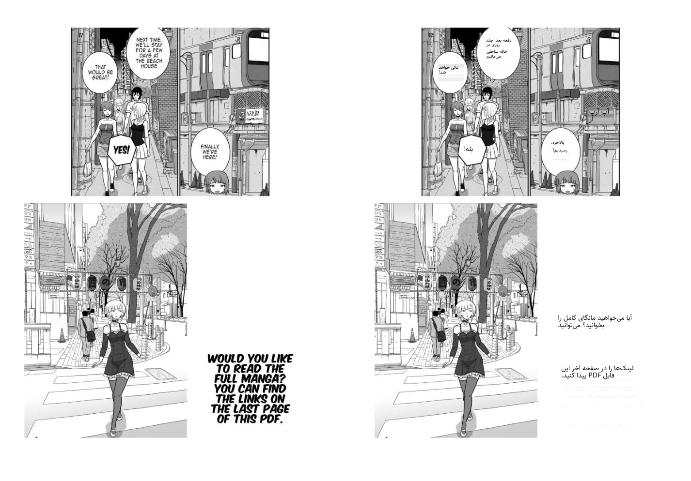
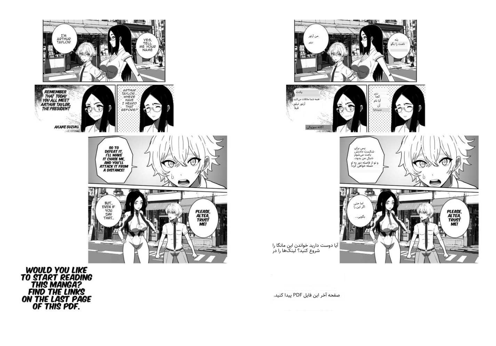

# ترجمهٔ «Josep Moore — Mangas ENG» (۱۶ صفحه) — انگلیسی → فارسی

مجموعهٔ نمونهٔ مانگا: جلدها + چند صفحهٔ داستانی با حباب گفتگو. فایل هیچ لایهٔ متنی ندارد (اسکن/تصویر خالص)، پس همهٔ ۱۶ صفحه با OCR خوانده شد.

| فایل | توضیح |
| --- | --- |
| [02_translated_fa.pdf](02_translated_fa.pdf) | خروجی فارسی |
| [01_original.pdf](01_original.pdf) | فایل اصلی برای مقایسه |
| [metrics.json](metrics.json) | اعداد اجرا و نتیجهٔ بررسی |
| [screenshots/](screenshots) | قبل/بعد هر صفحهٔ نمونه |

## نتیجه

| مورد | مقدار |
| --- | --- |
| صفحه | ۱۶ (همه) |
| بلاک متن | ۲۰۱ |
| ترجمه‌شده | ۱۹۱ |
| بلاک ناموفق | ۶ (نویسه‌های ریز تزئینی روی جلدها) |
| نویسهٔ فارسی | ۳٬۱۱۶ |
| زمان ساخت PDF | ۱۲ ثانیه (به‌علاوهٔ OCR و ترجمه) |

## دو تغییر که همین فایل لازم داشت

* **OCR با رندر کوچک‌تر دوباره امتحان می‌شود.** صفحهٔ شلوغ مانگا با ۲۰۰ dpi از موتور رایگان برمی‌گشت خالی؛ حالا خودکار با ۱۵۰ و ۱۲۰ dpi تکرار می‌شود و صفحه دیگر بی‌ترجمه نمی‌ماند.
* **کادر متن داخل حباب نفس می‌کشد.** حباب یک خط انگلیسی کوتاه دارد ولی فارسی بلندتر است. حالا فقط فضای خالیِ داخل حباب باز می‌شود (هر خط یا ستونی که مرکب داشته باشد سد است) و متن بزرگ و خوانا می‌نشیند، ولی پوشاندنِ متن قدیمی دقیقاً در جای خودش می‌ماند تا خط دور حباب خراب نشود.

## محدودیت‌ها

* ۶ بلوک (عدد صفحه، نویسه‌های تزئینی جلد) ترجمه نشدند و به‌صورت اصلی مانده‌اند.
* ۸ بلوک متن‌شان کوچک‌تر از بقیه است (حباب‌های خیلی باریک) و ۵ تکرار در متن دیده می‌شود؛ هیچ متنی بیرون از حباب یا روی متن دیگر نیفتاده است.
