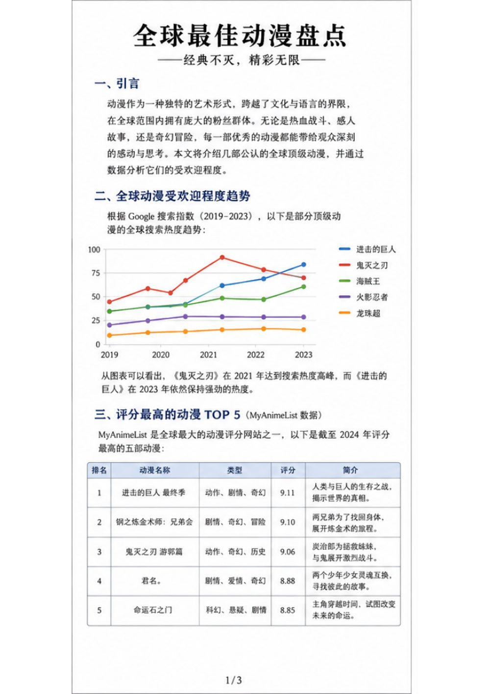
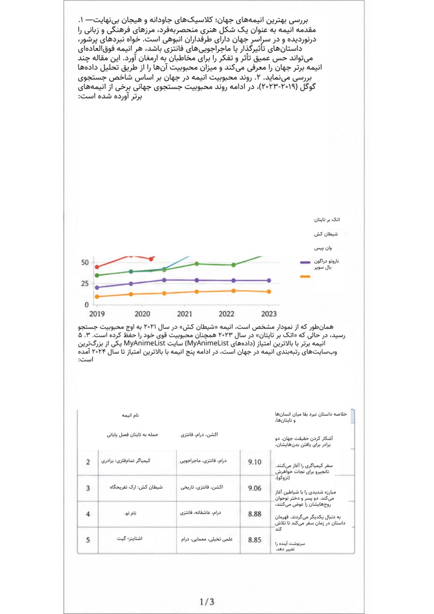
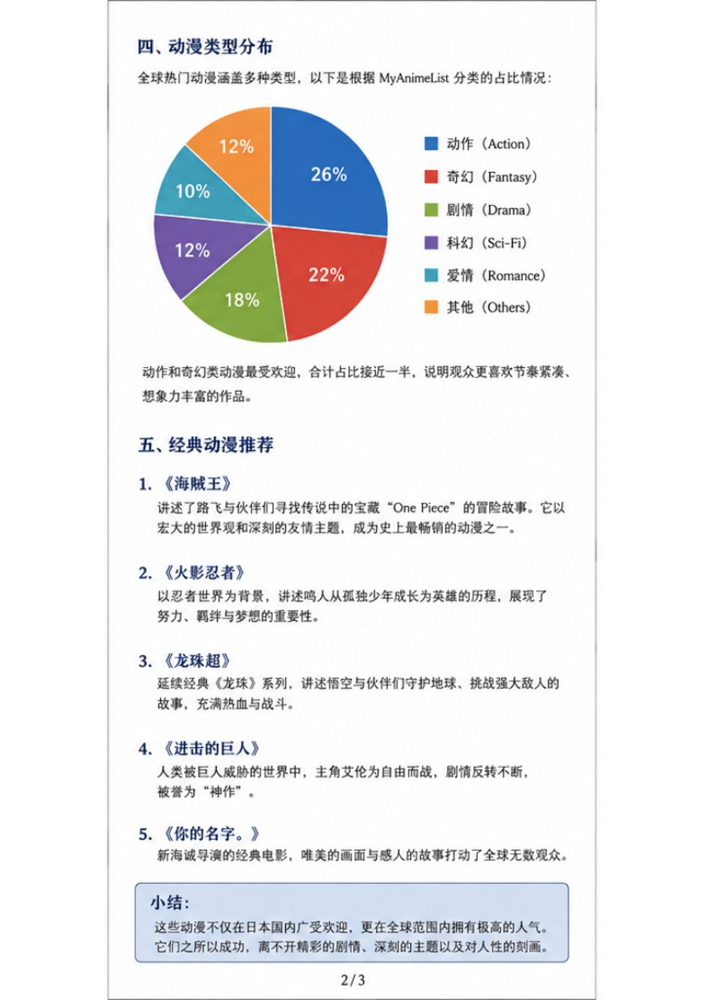
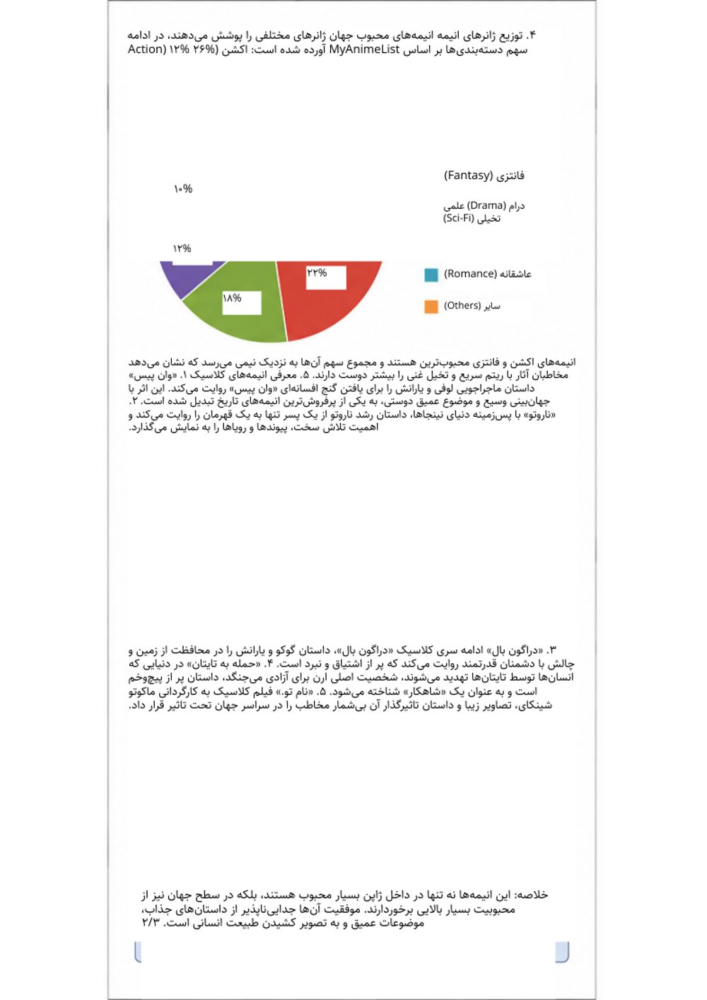
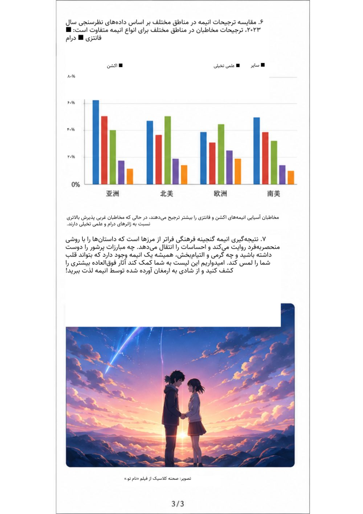

# تست OCR.space — چینی → فارسی (۳ صفحه، فقط تصویر)

موتور OCR: **OCR.space** (کلید رایگان، `language=chs`، موتور ۲) — ۳ صفحه، ۳ درخواست، ۱۳۱۷ نویسه، ۷.۳ ثانیه
ترجمه: **Gemini رایگان** — `gemini-3-flash-preview` (۲۵ ثانیه) و `gemini-flash-lite-latest` (۱۳.۵ ثانیه)

| فایل | توضیح |
| --- | --- |
| [01_original.pdf](01_original.pdf) | PDF اصلی چینی، دست‌نخورده |
| [02_ocrspace_ocr.pdf](02_ocrspace_ocr.pdf) | همان صفحات + لایهٔ متنی OCR.space |
| [03_translated_gemini-gemini-3-flash-preview.pdf](03_translated_gemini-gemini-3-flash-preview.pdf) | ترجمه با Gemini 3 Flash Preview (رایگان) |
| [04_translated_gemini-gemini-flash-lite-latest.pdf](04_translated_gemini-gemini-flash-lite-latest.pdf) | ترجمه با Gemini Flash Lite (رایگان) |
| [metrics.json](metrics.json) | عددهای اندازه‌گیری‌شده |
| [ocr_blocks.json](ocr_blocks.json) | بلاک‌های خام OCR.space |
| [screenshots/](screenshots) | تصویر تک‌تک صفحات و مقایسه‌ها |
| [بخش ۱۷ گزارش QA](../../../QA_REPORT.md) | توضیح پرووایدر، تست‌ها و محدودیت‌ها |

## صفحهٔ ۱ — اصلی و ترجمه‌شده

## صفحهٔ ۲

## صفحهٔ ۳

**وضعیت این اجرا در یک نگاه:** ۷۴ بلاک، ۴۶ نوشته‌شده، ۰ ناموفق، ۰ نویسهٔ چینی باقی‌مانده، ۰ علامت سؤال.
OpenRouter در این اجرا تست نشد چون سهمیهٔ رایگان روزانهٔ حساب (۵۰ درخواست) تمام شده بود.
