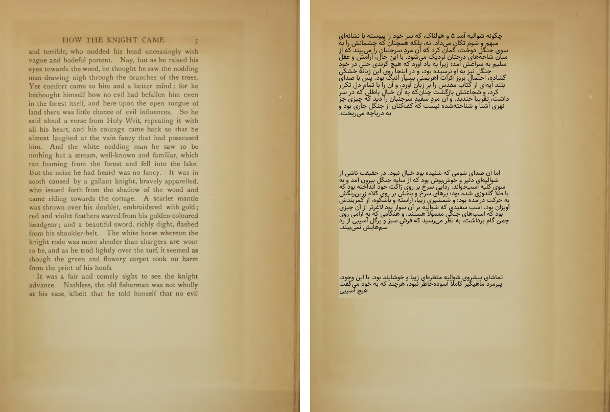
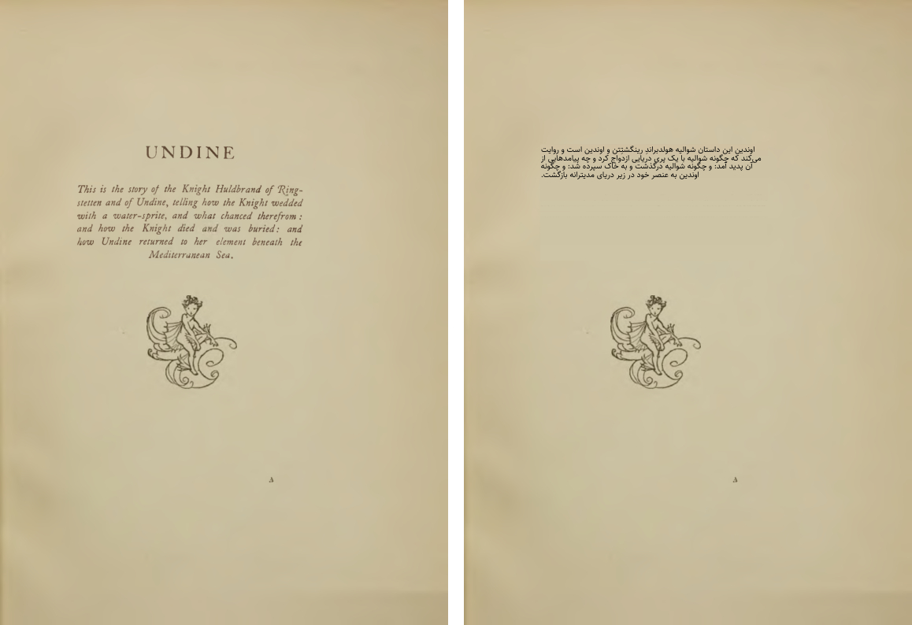

# ترجمهٔ کتاب اسکن‌شدهٔ Undine (۲۱۰ صفحه) — انگلیسی → فارسی

فایل: `MU_KPB_013_Undine_-_Illustrated_by_Arthur_Rackham.pdf`
کتاب اسکن‌شده با لایهٔ متنی ناقص؛ تصویرهای آرتور رکهام روی هر صفحه هستند.

| فایل | توضیح |
| --- | --- |
| [02_translated_fa.pdf](02_translated_fa.pdf) | خروجی فارسی (۲۱۱ صفحه: ۲۱۰ صفحهٔ کتاب + یک صفحهٔ معرفی تراریوم) |
| [metrics.json](metrics.json) | اعداد اجرا، نتیجهٔ QC و وضعیت پرووایدرها |
| [run.log](run.log) | لاگ کامل اجرا |
| [screenshots/](screenshots) | تصویر صفحه‌های نمونه، قبل و بعد، و مقایسهٔ کنار هم |

## نتیجهٔ اجرا

| مورد | مقدار |
| --- | --- |
| صفحه | ۲۱۰ (همه ترجمه شدند؛ صفحه‌های تصویری دست‌نخورده) |
| بلاک متن | ۸۲۶ |
| ترجمه‌شده | ۷۷۶ |
| نویسهٔ فارسی | ۱۱۵٬۵۲۴ |
| نویسهٔ لاتین باقی‌مانده | ۱۴۸ (نام‌ها و عنوان‌های لاتین) |
| بلاک ناموفق | ۳ |
| نتیجهٔ QC | ✅ بدون ایراد ساختاری |
| زمان | ۲۸۱ ثانیه (۴ دقیقه و ۴۱ ثانیه) |

## کاری که برای این کتاب خاص لازم بود

* **لایهٔ متنی، تصویر را نمی‌پوشاند.** متن کتاب داخل تصویر اسکن چاپ شده است؛ پاک‌کردن لایهٔ متنی، حروف چاپی را باقی می‌گذارد. بنابراین صفحه‌هایی که تصویر تمام‌صفحه دارند مثل صفحهٔ اسکن‌شده رفتار می‌کنند: کادر متن با رنگ خود کاغذ پوشیده می‌شود، بعد فارسی روی آن می‌نشیند.
* **بدون مستطیل سفید.** رنگ پوشش از خود کاغذ نمونه‌برداری می‌شود (نوار به نوار، چون کاغذ گرادیان دارد)، پس به‌جای کادر سفید، وصله‌ای هم‌رنگ کاغذ دیده می‌شود.
* **متن روی تصویر ترجمه نمی‌شود.** اگر بلوکی روی نقاشی بنشیند، دست‌نخورده می‌ماند تا تصویر خراب نشود.
* **هشت صفحهٔ خراب‌خوانده با OCR اصلاح شدند** (صفحه‌های عنوان و تزئینی که لایهٔ متنی‌شان آشغال بود: `12,17,21,23,37,55,83,191`). بعد از OCR، متن واقعی آن‌ها هم ترجمه شد.
* **صفحه‌هایی که متن‌شان کاملاً آشغال است** اصلاً ترجمه نمی‌شوند تا روی نقش و نگار چیزی چاپ نشود.
* **زنجیرهٔ جایگزینی مدل:** `gemini-flash-lite-latest` وسط کار به سهمیه خورد (429) و خودکار حذف شد؛ مدل بعدی فارسی ادامه داد. هیچ بلاکی نیمه‌انگلیسی رها نشد.

## مقایسه

## محدودیت‌ها

* سه بلاک ترجمه نشدند (متن‌های تزئینی/کوتاه لبهٔ تصویر) و به‌صورت اصلی مانده‌اند.
* لایهٔ متنی فارسی برای کپی/پیست در چند حرف (مثلاً «ی») کاراکتر اشتباه می‌دهد؛ ظاهر متن درست است اما انتخاب و کپی متن بی‌نقص نیست.
