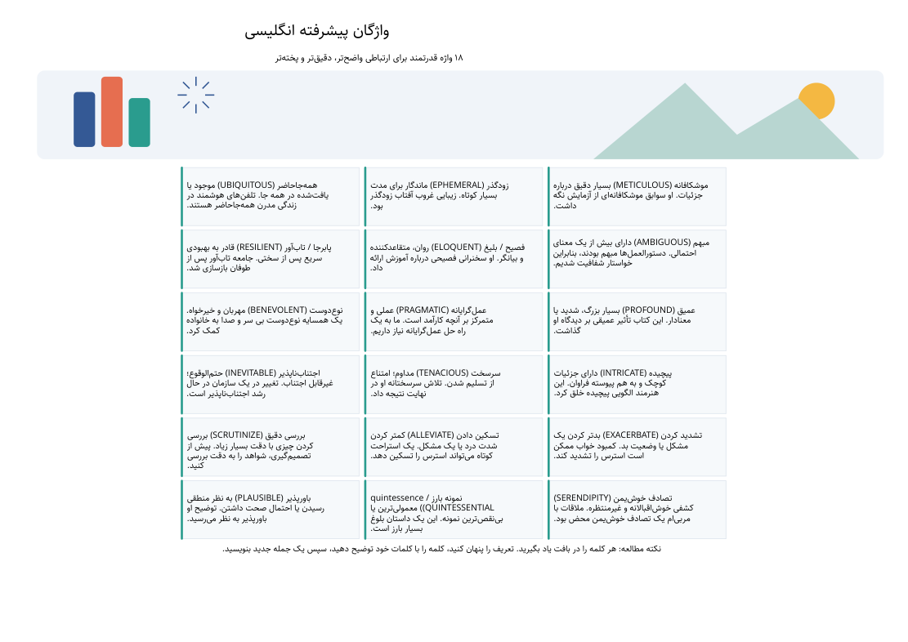
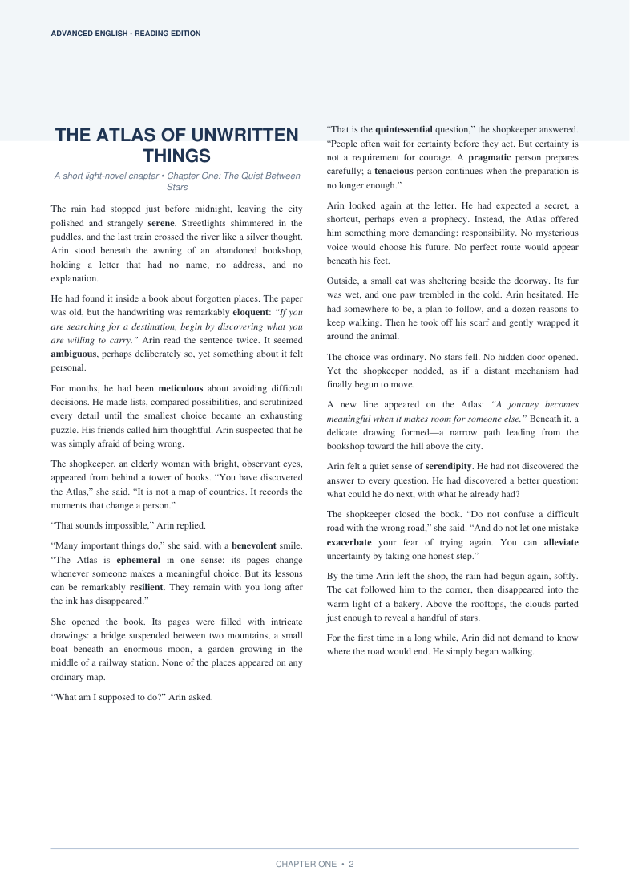
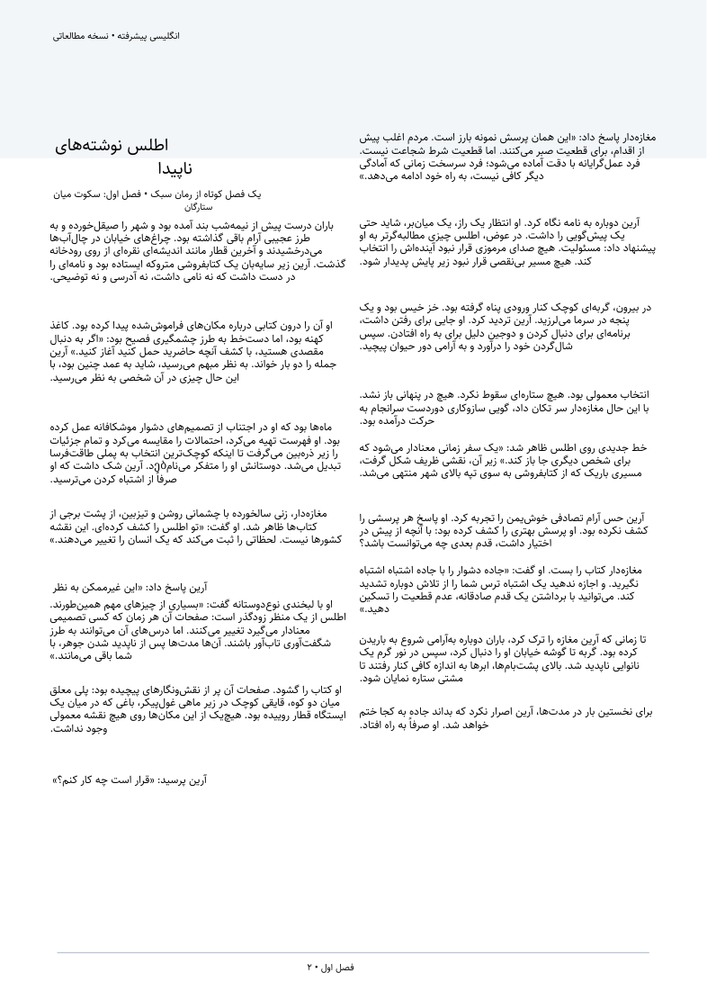
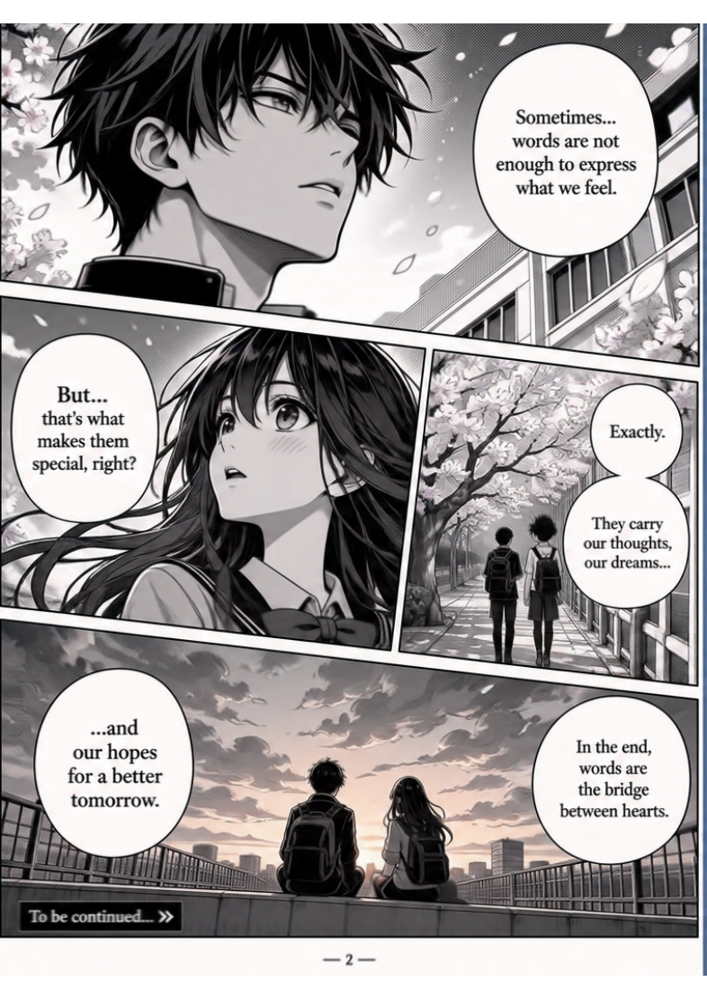

# ترجمهٔ PDF واژگان انگلیسی → فارسی (۳ صفحه) — با «آتش نهایی»

فایل: `advanced_english_vocabulary_light_novel_manga.pdf` (۳ صفحهٔ افقی ۸۴۲×۵۹۵)
صفحه‌های ۱ و ۲ متن واقعی دارند (بدون OCR)، صفحهٔ ۳ فقط تصویر است و با OCR.space رایگان OCR شده.
هر دو اجرا با آتش نهایی: بازبینی خودکار ترجمه توسط مدل + بررسی خروجی با PDF اصلی.

| فایل | توضیح |
| --- | --- |
| [01_original.pdf](01_original.pdf) | PDF اصلی دست‌نخورده |
| [02_translated_gemini-gemini-flash-lite-latest.pdf](02_translated_gemini-gemini-flash-lite-latest.pdf) | ترجمه با Gemini (رایگان) |
| [03_translated_openrouter-nemotron-3-ultra-550b-a55b:free.pdf](03_translated_openrouter-nemotron-3-ultra-550b-a55b:free.pdf) | ترجمه با OpenRouter (مدل رایگان) |
| [metrics.json](metrics.json) | اعداد + نتیجهٔ QC هر پرووایدر |
| [screenshots/](screenshots) | تصویر هر صفحه، قبل و بعد، و مقایسه‌ها |

| پرووایدر | بلاک | ترجمه‌شده | ناموفق | بازبینی مدل | QC | نویسهٔ فارسی | زمان |
| --- | --- | --- | --- | --- | --- | --- | --- |
| Gemini flash-lite | ۵۹ | ۵۸ | ۰ | ۱ | ✅ بدون مشکل | ۴۱۲۱ | ۱۶.۲ ثانیه |
| OpenRouter nemotron | ۵۹ | ۵۸ | ۰ | ۰ | ⚠️ ۱ بلاک تکراری | ۳۸۱۰ | ۱۶۵.۶ ثانیه |

## صفحهٔ ۱

## صفحهٔ ۲

## صفحهٔ ۳ (مانگا)

