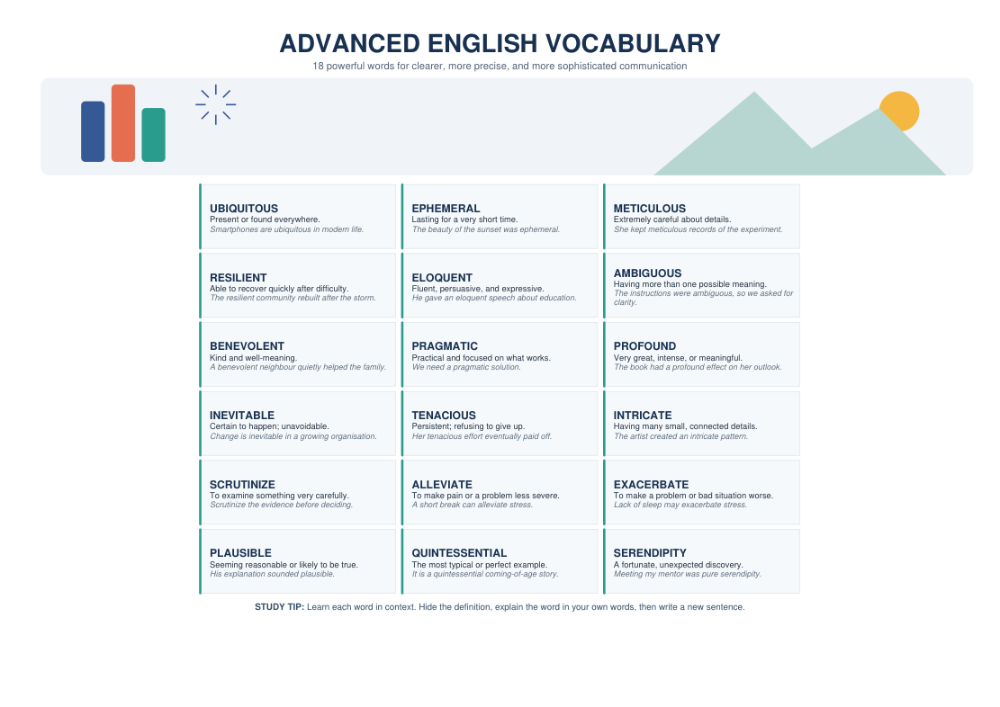

# ترجمهٔ PDF واژگان انگلیسی → فارسی (۳ صفحه)

فایل ورودی: `advanced_english_vocabulary_light_novel_manga.pdf` (از مخزن، صفحه‌های افقی 842×595)
موتور: ترجمهٔ متنی بومی برای صفحه‌های ۱ و ۲ (لایهٔ متن واقعی) + OCR.space رایگان برای صفحهٔ ۳ که فقط تصویر است
مترجم: Gemini `gemini-flash-lite-latest` (رایگان) — ۱۶.۱ ثانیه

| فایل | توضیح |
| --- | --- |
| [01_original.pdf](01_original.pdf) | PDF اصلی، دست‌نخورده |
| [02_translated_gemini-gemini-flash-lite-latest.pdf](02_translated_gemini-gemini-flash-lite-latest.pdf) | خروجی فارسی تراریوم |
| [screenshots/](screenshots) | تصویر هر سه صفحه، قبل و بعد، و مقایسه‌ها |
| [metrics.json](metrics.json) | عددهای اندازه‌گیری‌شده |

**نتیجه:** ۵۹ بلاک، ۵۸ ترجمه‌شده، ۰ ناموفق، ۰ خطای درج، ۴۱۸۲ نویسهٔ فارسی، ۰ علامت سؤال. اندازه و جهت صفحه‌ها مثل اصل (افقی) حفظ شده و صفحهٔ چهارم صفحهٔ انتساب است.

## صفحهٔ ۱ — فهرست واژگان

## صفحهٔ ۲ — داستان کوتاه

## صفحهٔ ۳ — صفحهٔ مانگا (فقط تصویر، با OCR.space)

